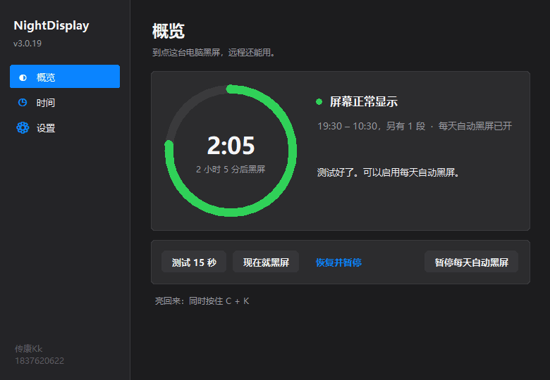
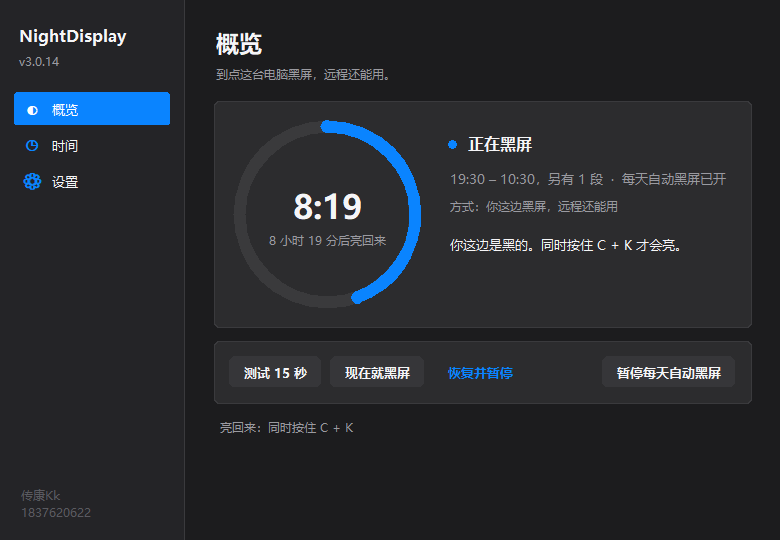
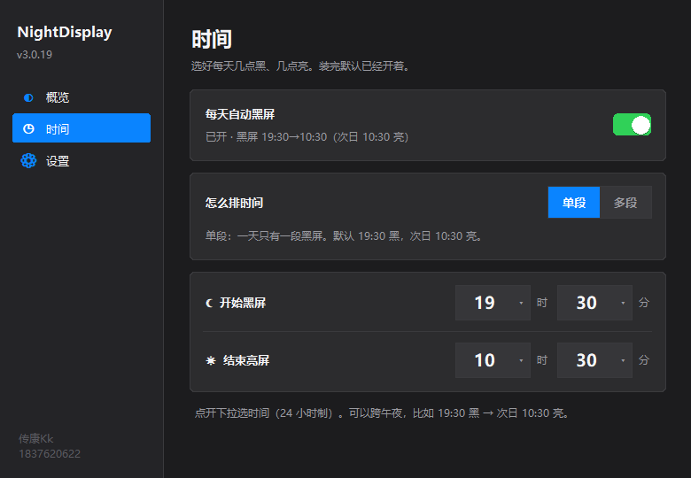
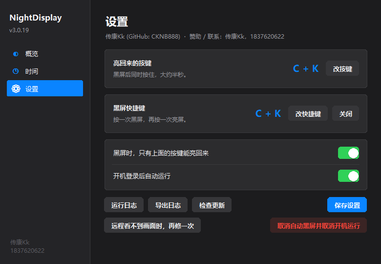

# NightDisplay

**下班后让本机屏幕纯黑，远程照常用。** NightDisplay 是一个屏幕防窥工具：到了设定时间，电脑仍在运行，但本地屏幕不再显示桌面，旁边路过的人看不到你的内容；你继续通过 UU 远程、ToDesk 等软件连接、操作。

默认每天 **19:30 自动黑屏，次日 10:30 自动亮屏**（跨午夜，按电脑本地时区），可自行修改，也可以再加几段时间。

> **只支持 Windows。** 远程照常用、本地纯黑，靠的是 Windows 的虚拟显示器驱动（IddCx VDD）和 `SetDisplayConfig` 显示拓扑。macOS 没有同样的虚拟屏方案，Linux 也没有通用的做法，所以这两个平台只剩“基础关屏”，不提供虚拟屏防窥，也不提供 C + K 快捷键，不再投入开发。
>
> **系统要求：** Windows 10 或 11，64 位（安装器会拒绝更老的系统）。黑幕模式需要 Windows 10 2004（19041）及以上，老一点的 Win10 会自动跳过黑幕模式，只用虚拟屏或关屏。**Windows 7 / 8 / 8.1 不支持**：程序基于 Python 3.12，而虚拟显示器驱动（IddCx）要 Windows 10 才有，这两样在 Win7 上都装不上，所以不会假装兼容。

作者：传康Kk。赞助：微信 1837620622（请备注来意）。

[下载 3.0.19](https://github.com/CKNB888/NightDisplay/releases/tag/v3.0.19) · [所有版本](https://github.com/CKNB888/NightDisplay/releases) · [反馈问题](https://github.com/CKNB888/NightDisplay/issues)

| 下载 | 说明 |
|---|---|
| [NightDisplay-Windows-x64-Setup.exe](https://github.com/CKNB888/NightDisplay/releases/download/v3.0.19/NightDisplay-Windows-x64-Setup.exe) | Windows 10 2004+/11 安装版，按当前用户安装 |
| [NightDisplay-Windows-x64.zip](https://github.com/CKNB888/NightDisplay/releases/download/v3.0.19/NightDisplay-Windows-x64.zip) | 免安装版，解压即用 |

## 适合什么场景

- 办公室一体机下班不关机，人走后屏幕纯黑，路过的人看不到桌面，回家照常远程。
- 公共位置的电脑：远程操作时本地不显示画面，保护屏幕隐私。
- 只想按时黑屏、按时亮屏，不想每天手动关显示器。

## 界面



深色、圆角卡片、左侧栏的 Mac 风格界面。上面的动图和下面的截图，都是 GitHub Actions 的 Windows 机器上运行 **3.0.19** 真实程序窗口截下来的（`tools/capture_ui.py`），不是效果图。侧栏版本号、设置里的「黑屏快捷键」等，都和当前安装包一致。

| 概览：倒计时圆环 | 黑屏中：距离亮屏 |
|---|---|
|  |  |
| **时间：步进器 + 开关** | **设置：其他时段、C+K 快捷键、开关** |
|  |  |

## 日常使用

Windows 默认优先使用常驻虚拟屏。进入夜间时，桌面只输出到虚拟屏，实体屏从桌面布局中移除；恢复时还原原来的显示配置。普通鼠标和键盘输入不会重新启用被移除的实体输出。

如果虚拟屏无法使用，程序先回滚，再按系统能力尝试防窥黑幕和基础关屏。界面和日志会记录实际使用的方式。基础关屏兼容性较好，但输入会唤醒屏幕；它无法提供虚拟屏相同的效果。

NightDisplay 只负责显示、电源和时间计划。远程连接仍由 UU、ToDesk 等软件提供，不绑定设备，也不限制客户端数量；远程软件自身的会话规则继续生效。

## 检查更新（Windows）

程序打开约 3 秒后会自动查一次 [GitHub Releases Latest](https://github.com/CKNB888/NightDisplay/releases/latest)。有新正式版时只问一次「立即更新？」：点是就自动下载官方 Setup、跑 `cleanup_old.ps1` 清旧进程/注册表/残留，再 `/VERYSILENT` 静默安装并拉起新版托盘。设置页「检查更新」同样。**不会在未确认时自动安装。**

## 点 X 进托盘 / 后台守护（Windows）

点窗口右上角关闭，程序进托盘后台，计划与开机自启都还在；真正退出请用托盘菜单「退出 NightDisplay」。Windows 还会注册每 5 分钟一次的 `NightDisplay_Watchdog`：常驻进程异常退出后会再拉起托盘；你主动退出后不会强行拉起。

## 快捷键（Windows）

| 按键 | 作用 |
|---|---|
| 同时按住 **C + K**（约 0.3 秒） | 默认的黑屏快捷键：白天按一下立刻黑屏，黑屏中再按一次亮屏。窗口藏到托盘也有效。 |
| **Ctrl + Alt + Shift + R** | 应急恢复：不管什么状态都把显示恢复过来。 |

- 在「设置 → 黑屏快捷键」里点「改快捷键」，同时按下 2～3 个键（可以带 Ctrl / Alt / Shift），再点「保存设置」，马上生效、写进配置，重启后还在。点「关闭」可以停用。
- 开着“黑屏锁定”时，快捷键不会绕过锁定：亮屏仍然靠「亮回来的按键」（默认也是 C + K，按住约半秒）。
- 系统在用的组合（Alt + F4、Alt + Tab、Win + L 等）和应急恢复键不能设成黑屏快捷键，设置时会提示换一个。键检测不可用时会写进运行日志。
- 实现方式：每 50 毫秒读一次按键状态（`GetAsyncKeyState`）。不装键盘钩子，不拦截输入，打字照常；按住 0.3 秒才触发，打字时碰巧同时按到 C 和 K 不会黑屏。

## 怎么用这个界面

左边三栏：**概览**、**时间**、**设置**，切换时内容轻轻滑入（约 0.18 秒）。概览的大圆环显示离黑屏还有多久；黑屏中显示离亮回来还有多久。圆环只在窗口打开时每秒更新，关掉窗口（藏到托盘）后不再重画，弱一体机上不额外占 CPU。

「时间」页里开始、结束用 − / + 步进器调，按住连续变，滚轮也行，点数字直接选；改完约 1 秒自动保存。下面的开关就是「每天自动黑屏」。托盘图标右键有：现在就黑屏、现在恢复屏幕、恢复屏幕并暂停、暂停每天自动黑屏、设置…、退出。

开始和结束各一行，不用打字。每天自动黑屏开着时也能改时间，改完按新的时间走。点一次「测试 15 秒」，屏幕黑 15 秒后自己亮回来，这次测试不改已选的时间。每天自动黑屏还开着时，要先暂停再测。测好之后点右边的「启用每天自动黑屏」。

「现在就黑屏」会先说明怎么亮回来。「恢复屏幕并暂停」把屏幕弄亮，并暂停每天自动黑屏。开机后仍会在后台运行。

「运行日志」旁边可以「导出日志」，把保存的日志存成一个文本文件。设置里可以再加最多几段其他时间，同样是下拉选择；亮屏按键点「改按键」同时按下，不用手填。黑屏时这台电脑默认同时按住 C 和 K。

进入夜间后，本机看到的是纯黑，没有文字、图标或动画。远程画面不经过这层黑。

## 安装

| 平台 | 文件 | 使用方法 |
|---|---|---|
| Windows 10/11 x64 | `NightDisplay-Windows-x64-Setup.exe` | 双击安装。向导是中文，第一次不用选文件夹。装完后桌面有 NightDisplay，安装结束会自己打开。驱动随包内置，首次打开自动装好；驱动进系统才弹一次管理员确认，点了取消也照常打开、自动用黑幕模式。开机登录后会在右下角自己运行，到了设定时间就黑屏。点窗口右上角的关闭只是藏起来。 |
| Windows 免安装 | `NightDisplay-Windows-x64.zip` | 解压到固定目录，运行 `NightDisplay.exe`。这个包不会在桌面建图标。开启计划后不要移动程序。 |

安装包尚未使用商业代码签名。源码、构建日志和校验值应一并核对，不能把未签名当成已经通过平台认证。**不提供 macOS / Linux 安装包**：没有可用的内置虚拟屏路径，这两个平台已放弃。

源码运行（Windows）：

```bash
python -m pip install '.[tray]'
python -m nightdisplay
```

## 第一次配置

1. 先确认远程软件已能正常连接这台电脑。
2. 不用手动装驱动。驱动随 Windows 包内置，安装程序和首次打开都会写好开机自启（HKCU Run 的 NightDisplay，普通用户就有权限）。装不上或点了取消管理员确认，软件照常打开、自动降级到黑幕模式。想再修一次，打开“设置”，点“远程看不到画面时，再修一次”。源码运行前先执行 `python tools/download_vdd.py`。运行中黑屏本身是纯黑，不带任何文字。
3. 每天的开始和结束在主窗口点开选择，选完会自己记下。还要中午等时段时，打开“设置”，点“再加一段”，同样点开选择。
4. 点“测试 15 秒”。不用先改时间。程序会先启动独立恢复进程，再切换显示；大约 15 秒后屏幕自己亮回来。每天自动黑屏还开着时，要先暂停再测。
5. 测试恢复后，检查这台电脑的屏幕是否正常、远程是否能看到桌面，再点“启用每天自动黑屏”。超过一天的测试结果不能直接拿来启用。

本地默认同时按住 C 和 K 大约半秒解除。可以在设置里点“改按键”，同时按下 2 个或 3 个键。组合键解锁后，本次夜间剩余时间不再自动黑屏。

启用黑屏锁定时，程序内的本地恢复、应急快捷键和退出操作都不会解除黑屏。远程恢复可运行：

```text
NightDisplay.exe --action emergency
```

Windows 压缩包也提供 `Recover.cmd`。应急恢复会恢复显示并暂停计划。这里的锁定是程序的操作限制，不是操作系统的权限隔离；系统显示设置和恢复命令仍可改变屏幕状态。

## 默认设备和电源配置

新安装的 Windows 虚拟屏采用一块 1920×1080、60 Hz 的显示器配置，关闭自定义 EDID 和额外 HDR 选项。已有驱动的用户配置不会被直接覆盖。

内置驱动固定使用 VirtualDrivers 的 `25.7.23` 版本。构建时校验下载 ZIP 的 SHA-256，安装前再次核对 INF、DLL、CAT 的固定校验值和目录签名。安装期间只临时信任已经通过固定文件校验和有效签名检查的驱动签名者，结束时移除本次新增的发布者条目。详细来源见 [NOTICE.md](NOTICE.md)。

Windows 夜间使用临时电源计划，关闭该计划下的自动睡眠、自动休眠和合盖睡眠。防窥黑幕保持显示渲染唤醒，避免黑窗口跟着显示器关掉。仅虚拟屏只保持系统唤醒，允许显示器空闲，一体机背光可以灭。原电源计划保存在切换记录中，恢复后重新启用并删除临时计划，不会全局关闭 Windows 的休眠功能。如果你在夜间主动选择了另一份电源计划，恢复时保留你的选择。

常驻进程定时检查显示输出和唤醒进程。虚拟输出发生改变时尝试修复，唤醒进程失效时重新启动；无法确认成功时报告错误并尝试恢复。断电、关机、低电量强制保护及系统或组织策略无法由应用保证。

## Windows 能力

| 能力 | 说明 |
|---|---|
| 每日多个时间段 | 计划任务 + 常驻检查 |
| 常驻虚拟屏 | 安装器内置 IddCx VDD，首次需要管理员权限 |
| 防窥黑幕 | Windows 10 2004（19041）及以上；更老的 Win10 自动跳过 |
| 基础关屏 | 支持，输入会唤醒（虚拟屏不可用时的降级） |
| 防睡眠 | 临时电源计划 + Windows 唤醒请求 |
| 显示备份与还原 | 支持，带多级恢复与目标校验 |
| 后台入口 | 系统托盘 |
| 黑屏快捷键 / 解锁组合键 | 默认 C + K，可自定义；`GetAsyncKeyState` 轮询，不装钩子 |

**不支持 macOS / Linux / Windows 7 / 8 / 8.1。** macOS 没有对等的内置虚拟屏；Win7/8 装不上 Python 3.12 与 IddCx VDD。

Windows 防窥黑幕依赖系统的 `WDA_EXCLUDEFROMCAPTURE`。设置成功只能说明 Windows 接受了请求，不能证明每一种远程采集方式都兼容。使用 UU、ToDesk 的实际画面仍需分别验证。

## 备份与恢复

进入虚拟屏模式前，程序保存当前显示路径和模式。最近十份备份会轮转，最近一次正常配置另存一份。配置文件、显示备份和电源记录采用完整文件替换；多进程修改配置时加锁，避免后台进程覆盖前台设置。

恢复优先还原完整显示配置，再尝试保存的拓扑、仅内屏、扩展和复制。每一级除了检查 API 返回码，还检查活动显示器；恢复失败不会把状态写成“白天”或“测试成功”。损坏的显示备份不会阻止尝试系统恢复。

IPC 按数据目录隔离，使用随机端口和会话凭据；没有回复的夜间命令不会被直接重复执行。后台进程不再读取磁盘里的 PID 后按名称杀进程，防止误杀其他 Python 或系统进程。

## 更新和卸载

启动后在后台查询 GitHub 最新正式 Release，也可以在设置里手动检查。查询失败写入日志，不阻塞主窗口；发现更新后由你选择是否打开下载页。程序不自动运行下载文件。

卸载前先运行“恢复并暂停”或远程恢复命令。Windows 安装器会在卸载前执行恢复和任务清理，恢复失败时停止卸载。设置中的“卸载计划与自启”会移除计划和自启项；显示备份与日志保留。

## 命令行

```text
NightDisplay --action status
NightDisplay --action selfcheck
NightDisplay --action night [--mode auto|virtual_only|overlay|screen_off]
NightDisplay --action day
NightDisplay --action test --mode auto --seconds 15
NightDisplay --action activate --start 19:30 --end 10:30
NightDisplay --action pause
NightDisplay --action emergency
NightDisplay --action uninstall
NightDisplay --action displays
NightDisplay --action plan-virtual
NightDisplay --action install-vdd
NightDisplay --action uninstall-vdd
```

夜间和测试命令会确保常驻进程存在，以便组合键和黑幕能工作。`plan-virtual` 只生成和校验方案，不改变输出。所有失败命令返回非零退出码；锁定状态下拒绝普通 `day` 命令时返回 2。

可用 `--home PATH` 指定数据目录，计划任务、恢复进程和唤醒进程会继承该目录。`--debug` 把完整错误堆栈同时打印到终端。

## 数据目录

| 平台 | 默认目录 |
|---|---|
| Windows | `%LOCALAPPDATA%\NightDisplay` |

包含 `config.json`、`backups`、`logs` 及运行时会话文件。日志保留最近三十天。报告问题时可以提供版本、`selfcheck` 输出和对应日志，无需提供远程账号或密码。

## 构建和测试

```bash
python -m pip install pytest pillow pystray build pyinstaller ruff
python -m pytest -v tests
python -m ruff check nightdisplay tests tools
python tools/ci_integration.py
python -m build --wheel
```

Windows 集成检查增加 `--vdd`。打包后的 EXE 由 `tools/qa_windows.py` 进行实际测试、组合键解锁、应急恢复、计划注册和卸载检查，不预填成功记录。

GitHub Actions 只跑 Windows：Windows 2022 和 Windows latest 单元测试 + VDD 集成测试 → 打包安装器与免安装包 → 对打包产物做 3 轮 QA。全部通过后，推送 `v*` 标签才会发正式 Release（只含 Windows）。macOS / Linux 构建和发版已从工作流移除。工作流也支持手动运行。

云端 VM 和 CI 没有你的实际一体机、UU/ToDesk 会话及真实背光控制。它们能验证操作系统接口、恢复和打包流程，不能代替硬件兼容性测试。没有跑过的机型和平台不标注为“已保证兼容”。

## 更新记录

### 3.0.19

- **装完即用**：默认开启每天自动黑屏，19:30 → 次日 10:30（本机时区），不用再点「启用」。
- **时间页**：单段 / 多段切换；小时、分钟用 24 小时下拉选，不能手打；多段可单独开关，段与段之间是亮屏空隙。
- **暂停不再改时间**：暂停后再启用，仍按已保存的 start/end，不会把到点时间推迟。
- 关窗口进托盘 + Windows 守护任务；静默更新会先跑 cleanup_old.ps1 再 /VERYSILENT 安装。
- README 界面图为 Windows CI 真实窗口（Actions run [42026750318](https://github.com/CKNB888/NightDisplay/actions/runs/42026750318) `ui-shots-windows-latest`）；界面图已换成含单段/多段时间页的最新 Windows CI 截图。
- **自动检查更新（Windows）**：启动约 3 秒后查 GitHub Releases Latest；有新版只问一次「立即更新？」。确认后自动下载官方 Setup、复用 `cleanup_old.ps1` 清旧进程/注册表/残留，再 `/VERYSILENT` 静默安装并拉起新版。设置里「检查更新」同样。
- **点 X 强制后台**：关闭窗口只进托盘；托盘起不来时不会把窗口藏死。Windows 注册 `NightDisplay_Watchdog`（每 5 分钟）：常驻进程挂了会再拉 `--tray`；托盘「退出」会写标记，守护不再拉起，直到你再次打开。

### 3.0.18

- README 界面图全部换成 Windows CI 上真实运行截下的 **3.0.18** 窗口（概览 / 黑屏中 / 时间 / 设置 + 巡览 GIF；来自 Actions run [42015681585](https://github.com/CKNB888/NightDisplay/actions/runs/42015681585) 的 `ui-shots-windows-latest`），设置页能看到「黑屏快捷键」C + K。不是 3.0.15 那批旧图。

### 3.0.17

- 仅虚拟屏回白天：先在黑幕下把实体屏接回来，再揭黑幕，减少亮屏时闪一下桌面（进夜间失败回滚本来就是这个顺序，回白天之前反了）。
- 仅虚拟屏夜间轮询从 1 秒改为 0.5 秒，远程结束后实体屏被顶亮时更快盖回（仍可能有最多约半秒可见）。
- CI 改为只跑 Windows 测试 / 打包 / QA / Release；macOS / Linux 构建与发版已去掉，避免无关红灯挡视线。
- README、安装说明、仓库描述与产品一致：只支持 Windows 10/11；快捷键重复判断清理。

### 3.0.15


- 新增黑屏快捷键：默认同时按住 C + K，按一次黑屏，再按一次亮屏；托盘后台也有效。可以在设置里改成别的组合或关掉，保存后马上生效。锁定时不绕过解锁按键。
- 虚拟屏修复：“仅虚拟屏”模式切换前先盖上黑幕，以前这一步会把系统光标也藏起来，远程画面里可能看不到鼠标指针，直到下一次检查。现在这一步只盖黑，不藏光标。
- 明确只支持 Windows 10/11 x64。安装器加了最低系统检查，README 写清 Win7/8 不支持的原因。macOS / Linux 不再承诺虚拟屏防窥。

### 3.0.14

- 全新深色界面（Mac / SwiftUI 观感，三个系统同一套）：左侧栏、圆角卡片、首页倒计时圆环、自绘开关和步进器，悬停/按下有反馈，切页滑入约 180 毫秒。Windows 10 20H1+/11 标题栏也是深色。仍然只用 Tk，不加新运行库。
- 窗口隐藏到托盘后，界面刷新完全停下；后台命令队列空闲时从每 30 毫秒改为每 100 毫秒看一次，弱机少很多唤醒。
- 托盘菜单加「暂停每天自动黑屏」和「设置…」。
- Windows 上另一个进程正在替换配置文件时，读配置会短暂“拒绝访问”。现在等一下重读，不再让检查或界面报错（Windows QA 抓到的真问题）。
- 进入「仅虚拟屏」失败回滚时，先在黑幕下把实体屏接回来再揭开黑幕，不再先露一下桌面。
- README 里的界面图全部换成 Windows 上真实运行截下的 3.0.14 窗口；去掉旧界面的宣传图。

### 3.0.13

- 默认时段改为每天 19:30 黑屏、10:30 亮屏。
- 远程中进入夜间不再卡死/断开：先把虚拟屏扩展进桌面、等 1.5 秒让远程软件切过去，再移除实体屏；扩展失败时退回原来的一步切换并记日志。
- 进入夜间时的亮一下：托盘程序在运行时，切换拓扑前先盖上黑幕（黑幕排除屏幕采集，远程看不到），切换失败回滚时揭开。
- 远程结束后实体屏被顶亮：夜间每秒检查一次，发现实体屏回来先盖黑再收回到虚拟屏（实际仍可能有不到 1 秒的延迟）。
- 内存与功耗：白天检查间隔从 1 秒改为 2 秒，每轮少读一次配置；关闭窗口藏到托盘时回收一次界面对象。
- 界面：状态和每天时段改成带边框的卡片，颜色仍跟随系统主题；打开窗口时约 150 毫秒淡入（只用 Tk 透明度，不额外占内存）。

### 3.0.12

- 15 秒测试结束、屏幕已经亮回来之后，Windows 有时会拒绝把状态写回文件。现在会重试，写不进改名就直接写入，避免一直停在“正在黑屏”。

### 3.0.11

- 开机登录后自动在右下角运行。Windows 如果在「启动」里关掉了 NightDisplay，下次打开会再打开这一项。只写当前用户的 NightDisplay，不动其他启动项。
- 登录或断电后再开机时，如果还在设定的黑屏时段里，直接黑屏，不先亮一下。这一段按过 C 和 K 之后再开机，才保持亮到本段结束。
- 点右上角关闭只是藏到右下角，每天的时间继续走。要退出，右键右下角图标，选「退出 NightDisplay」。退出才会把屏幕亮回来。
- 开始和结束各占一行，整颗按钮点开选时间。每天自动黑屏开着也能改，不用先暂停。测试 15 秒仍然要先暂停。

### 3.0.10

- 开始和结束时间改成小时、分钟下拉，只能点开选。设置里的其他时段同样是下拉，点“再加一段”或“去掉”。选完会自己记下，不再因为手填格式弹出“时间格式错误”。
- “测试 15 秒”不读取时间。点一下黑 15 秒，到点自己亮回来。每天自动黑屏开着时，先暂停再测。
- Windows 安装向导为中文。装完后桌面有 NightDisplay。安装程序写入开机登录自启。应急恢复保留这项；只有取消开机运行或卸载才关掉。程序正开着时卸载，也会关掉这一项。
- 主窗口和日志窗口可以导出全部日志。屏幕黑着的时候不弹出保存框。
- 仅虚拟屏夜间如果实体屏被重新点亮，先盖上排除采集的纯黑窗口再收回虚拟屏，黑窗口先留着，避免桌面亮一下。这层修复不改系统光标。回到白天时关掉。
- 界面文字改成可以直接跟着做的说法。现在就黑屏会先确认。

### 3.0.9

- 计划夜间如果虚拟屏或关屏临时失败，不再关掉每日计划，也不主动把屏幕亮回去。下一次检查会再试。
- 防窥黑幕窗口被系统拆掉后，会重新盖上全黑窗口。夜间不会因此把设置窗口亮出来。
- Mac 的基础关屏在键鼠点亮后，也会再次关屏。

### 3.0.8

- 读取 `HKCU\...\Run` 里的 `NightDisplay` 命令失败时，不再把开机自启整段跳过。读不到就当作没有这项。偏好是开，就按当前程序写上。

### 3.0.7

- 开机自启仍然只写 `HKCU\Software\Microsoft\Windows\CurrentVersion\Run` 的 `NightDisplay` 这一项，不写 HKLM，也不删除整个 Run 键。
- 程序路径或数据目录变了之后，再次打开会把 Run 里的旧命令换成当前程序。只看到“这项还在”不再当作已经写对。
- 暂停每日计划只删计划任务，不删 `NightDisplay` 这个登录项，也不改自启偏好。
- “卸载计划与自启”会把自启偏好改成关。下次打开不会把刚删掉的 Run 值写回去。应急恢复会删掉当前这项，但不改偏好；偏好如果还是开，下次打开再按当前程序写回。安装目录里的程序已经不在时，卸载器仍只删除这一个值名。
- 探测注册表能否写入时使用的 `NightDisplayEnvTest`，写完就删。删除失败也会再试一次，避免这个探测值留在启动项里。

### 3.0.6

- 黑幕替换系统光标时，只使用当前文档列出的 13 个标识，不再发送 32640 和 32641。换到一半失败时，立刻用 `SPI_SETCURSORS`（0x0057）把系统光标方案装回来。失败的那份空白光标不二次销毁。
- 第一次替换成功就在数据目录写下 `cursor-hidden.json`。进程被强行结束后，新进程、应急恢复、独立的白天恢复、测试恢复和中止测试都会看到这个标记并重载光标，不再只看本进程内存。重载成功后标记删除。重载本身失败时标记留着，下次再试。
- 环境诊断重写 `env.json` 时保留 `driver_auto_setup_at`。刷新诊断不会把七天冷却清掉。安装失败或取消管理员确认后，七天内不会反复弹出安装。
- 开机自启按保存的偏好写入 HKCU Run，和虚拟屏是否已经存在无关。写完回读，对不上只记日志，不挡住打开。
- Windows 显示备份里如果出现空记录或不是对象，这份备份作废，改走系统拓扑恢复。Linux 备份里的输出记录同样无效时，改走 `xrandr --auto`。
- 自动模式记下硬件能力指纹：可用模式、是否有虚拟屏、Windows 版本。同一套硬件上，测试实际通过的是防窥黑幕或基础关屏时，启用计划就按这个测到的方式运行，不会每晚再解析回仅虚拟屏然后失败。指纹变了必须重新测试。设置窗口会写明启用后实际使用的方式。
- 仅虚拟屏或基础关屏时进程被强行结束，下次启动先恢复实体屏和系统光标。恢复没完成就保持夜间状态，不会假装已经回到白天。防窥黑幕窗口随进程消失，启动时直接记回白天。计划如果仍在夜间，随后的定时检查会再进去。
- 两块虚拟屏同时存在时，优先空闲的内置 VDD by MTT，其次才是正在使用的内置 VDD。已经活动的 UU 等其他虚拟屏不会被当成夜间目标。
- Windows 计划任务若用 PowerShell 注册失败，先删掉同名任务，再改用 `schtasks /F` 覆盖。任务名仍是 `NightDisplay_Night`、`NightDisplay_Day` 和 `NightDisplay_Txx`。

### 3.0.5

- Windows 仅虚拟屏不再禁止显示器空闲：系统保持唤醒，一体机背光可以灭。防窥黑幕仍保持显示，避免黑窗口跟着显示器关掉。
- 防窥黑幕盖住整个虚拟屏幕，包括原点在主屏左侧或上方的副屏，并去掉圆角、边框和阴影。黑幕期间本机系统光标改为空白，退出夜间后恢复。仅虚拟屏不改光标，远程指针保持原样。
- 设置窗口在夜间收起。只有进入夜间前本来开着，白天才再显示；托盘自启不会因此弹出。夜间不再响应“打开主窗口”。
- 基础关屏会在夜间重复执行。键鼠把屏幕点亮后，下一轮检查会再关掉。
- Windows 每日计划在睡眠错过时间点后，醒来会补跑一次。计划模块不可用时仍退回原来的 schtasks 任务，任务名不变。
- 还原显示时先临时套用备份，确认已经出现实体屏，才写入系统显示数据库。备份里没有显示器名单时，也不会把只剩虚拟屏的结果写进去。
- 组合键或立即恢复若没走完，本段夜间也不会马上再黑一次。再次手动进入夜间会清掉上一次解锁。
- 只有虚拟屏时不再覆盖白天显示备份。Windows 不会把这种备份写进系统显示数据库。Linux 还原后必须还能看到实体输出。
- 名字里仅仅带 Virtual、或 Xorg 的 DVI-I-1-1，不再被当成虚拟屏。
- 不超过 1 分钟的夜间时段，手动进入后会保持到该段结束。
- 解锁和远程应急进了队列之后，客户端超时也不会把这次操作丢掉。
- 夜间电源记录丢失时，不会把正在用的夜间计划当成原来的计划。临时计划已经不存在时，不再挡住显示恢复。
- 托盘自启时装驱动和切换显示共用同一把动作锁。

### 3.0.4

- 白天手动进入夜间后，会保持到下一段计划的结束时间，不再被定时检查立刻拉回亮屏。
- 黑幕窗口只保留纯黑底色。进度动画留在设置窗口内，进入夜间后停止，避免本机看出电脑仍在运行。

### 3.0.3

- 托盘自启只唤醒已有常驻进程，不再重复弹出主窗口；托盘未在限定时间内就绪时回退到主窗口，避免只剩一个不可用的后台进程。
- 测试中断或提前退出不再记为成功；启用计划时要求实际解析出的模式与测试模式一致，防止自动模式在驱动或显示变化后误用旧测试结果。
- Windows 10 2004 以下不再显示不可用的防窥黑幕模式；旧系统会直接使用可用的虚拟屏或基础关屏。
- 配置校验覆盖运行时字段、正则表达式、组合键规范化和错误类型；损坏的电源记录、显示备份不会阻断恢复流程。
- IPC 严格校验端口，关闭操作可重复执行；退出时中止未完成测试并再次尝试恢复显示。
- 计划状态能识别额外时间段任务；日志目录不可写时不再影响显示或恢复操作。
- 增加 Ruff 检查配置和本地 lint 基线，修复未使用导入、异常链、文件句柄和导入顺序等问题。

### 3.0.2

- 按最新 main 重新审计，修复虚拟屏切换中不兼容的 Windows API 参数，夜间配置不再写成系统永久显示布局。
- 增加恢复目标校验；恢复失败保留待恢复状态。基础关屏和黑幕恢复不再误用以前的虚拟屏备份。
- 修复配置并发覆盖、固定临时文件冲突、IPC 超时后重复执行和不同数据目录串用常驻进程。
- 测试增加会话 ID，旧的延迟恢复不会解除新的黑屏；实际使用的降级方式会写入测试记录。
- 防睡眠改为可撤销的独立进程，检查启动和心跳；增加临时 Windows 电源计划及原计划恢复。
- 虚拟屏安装增加固定校验值、真实退出码、设备健康检查和默认 1080p/60 Hz 配置。
- 主界面改为磨砂卡片，保留多时间段、组合键录制、自启、日志和后台更新检查。
- 修复 wheel 构建遗漏，安装脚本和默认设备配置随 Python 包分发。
- Windows QA 改为真实测试流程；正式发布依赖打包产物 QA，并增加 Windows 安装器和 macOS DMG。

### 3.0.1

- 修正 Linux 构建基线。
- 修正模式校验和预演命令。
- 修正外部命令的输出编码。
- 修正计划清理。
- Windows 包开始内置 VDD 驱动。
- 这一版的恢复状态、配置并发和测试覆盖仍不足，3.0.2 针对这些路径补充了修复和回归检查。

## 许可

MIT，见 [LICENSE](LICENSE)。第三方许可见 [NOTICE.md](NOTICE.md)。NightDisplay 是独立项目，与 UU 远程、ToDesk 没有隶属关系，也不使用它们的标识或素材。

## 升级 / 清理旧版本（3.0.17 起）

直接运行新版 Setup.exe 即可：安装器会先结束所有 NightDisplay 进程，静默卸载其他目录里的旧版本，删除残余的卸载登记和失效的开机启动项，把旧安装目录、失效快捷方式和「下载」里的旧 NightDisplay 安装包移到**回收站**，最后只保留这一个最新版本。
