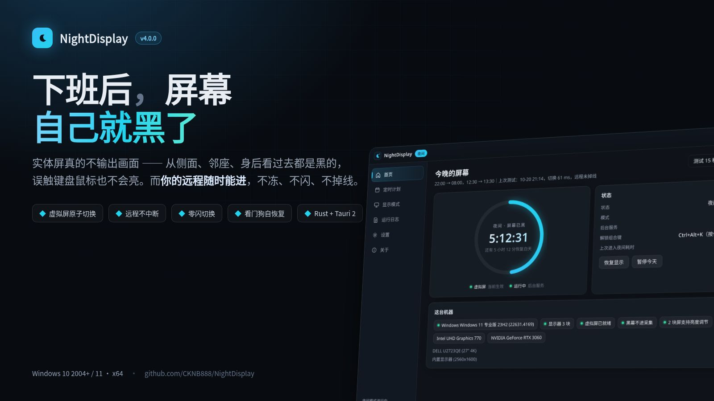
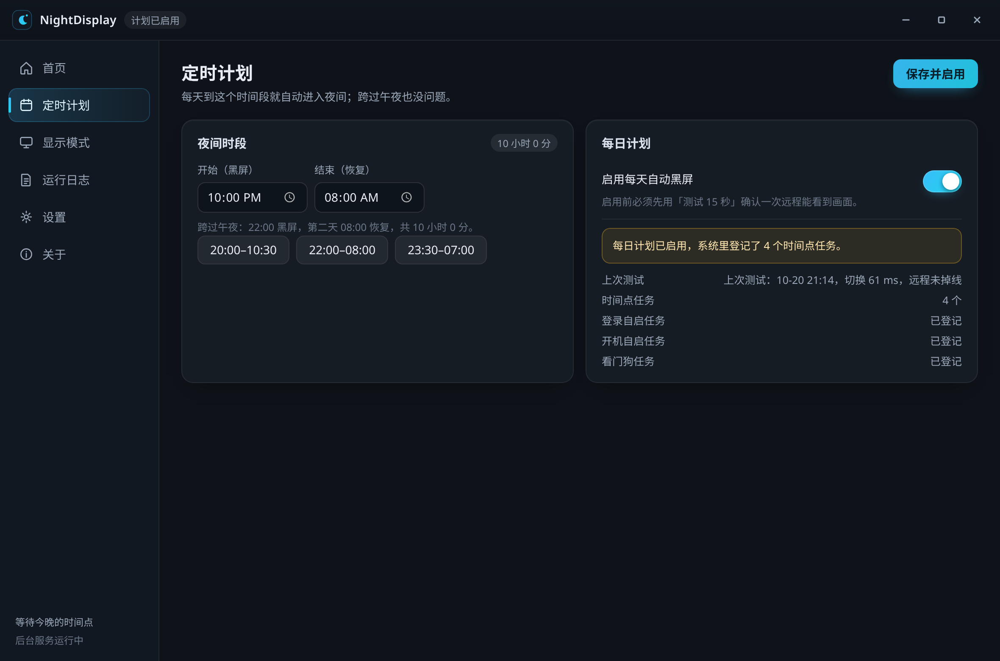
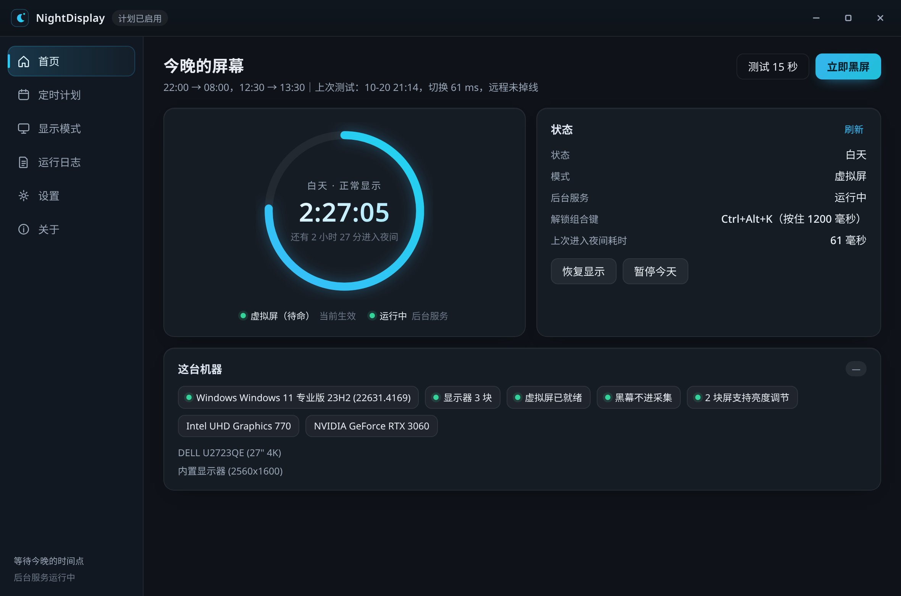
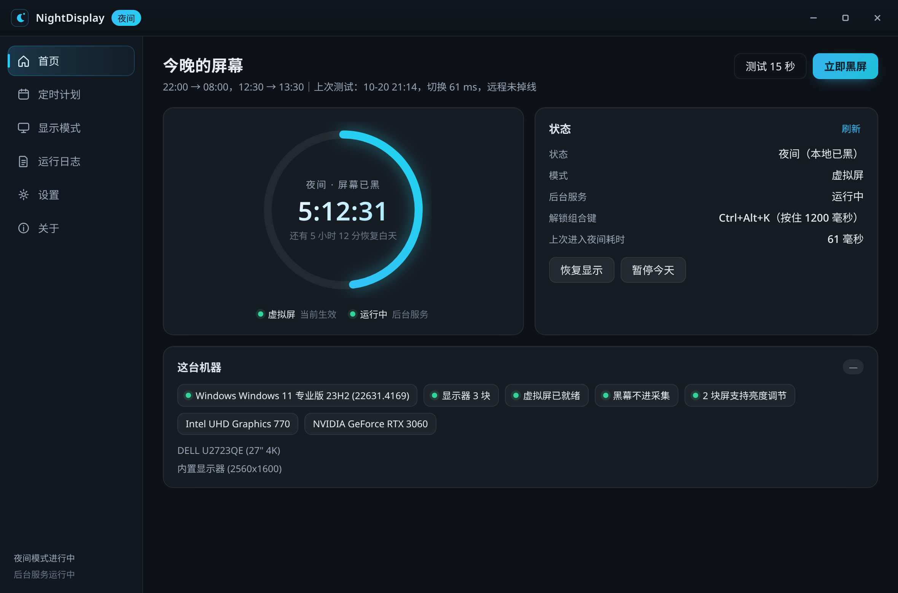
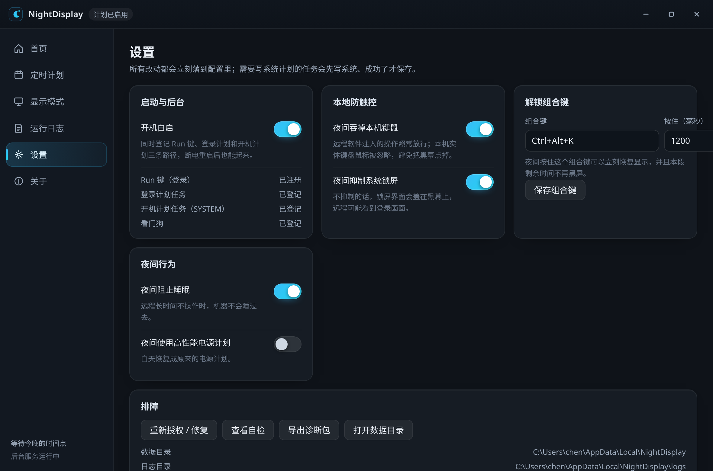
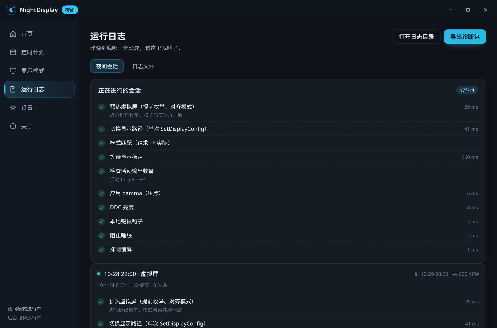

# NightDisplay 4

> **到点自动黑屏，保护你的屏幕隐私 —— 别人凑近看是黑的，误触也打不亮；而你自己的远程随时能进，不冻也不闪。**

下班或离开时，屏幕看起来就像已经关掉。它不是盖一层黑窗口：实体屏真的没有画面输出，
所以从侧面、从邻座、从身后看过去都是黑的。

只支持 **Windows 10 2004（build 19041）及以上，x64**。

[](docs/promo/nightdisplay-4.mp4)

> **宣传片**：下班后屏幕自动变黑，别人凑近看也是黑的；你从手机连回来，照常能操作。
> *（`docs/promo/nightdisplay-4.mp4`，封面 `docs/promo/poster-4.jpg`；点封面播放。）*

截图见 [`docs/screenshots/`](docs/screenshots/)（4.x 截图放在 `docs/screenshots/4/`）。

> ### 💬 定制与赞助
> 个人使用免费；**接受赞助、商业授权与私人定制** —— 微信 **1837620622**（添加请备注来意）。
> 企业可定制品牌界面、批量部署、静默安装、内部驱动分发、专用组合策略与技术支持。

[下载最新版 4.x](https://github.com/CKNB888/NightDisplay/releases/latest) ·
[反馈问题](https://github.com/CKNB888/NightDisplay/issues) ·
[更新日志](CHANGELOG.md) ·
[3.x 历史版本](https://github.com/CKNB888/NightDisplay/releases)

---

## 目录

| 章节 | 章节 |
|---|---|
| [一、为什么用虚拟屏](#一为什么用虚拟屏) | [七、显示模式](#七显示模式) |
| [使用场景](#使用场景) | [八、故障排查](#八故障排查) |
| [二、功能特性](#二功能特性) | [九、更新日志](#九更新日志) |
| [三、安装](#三安装) | [十、常见问题](#十常见问题) |
| [四、首次引导与授权](#四首次引导与授权) | [十一、参与与反馈](#十一参与与反馈) |
| [五、使用要点](#五使用要点) | [十二、赞助与定制](#十二赞助与定制) |
| [六、界面](#六界面) | [许可与致谢](#许可与致谢) |

---

## 一、为什么用虚拟屏

### 你想解决的问题

下班了、午休了、人离开工位了，屏幕却还亮着 —— 上面开着的聊天窗口、邮件、
表格、工单列表，路过的人一眼就能看见。

NightDisplay 做的就是这件事：**到点让屏幕看起来像已经关掉。**

* **到点自动黑屏**，不用每天手动点。
* **别人凑近看也是黑的** —— 侧面看、正面看、从身后看，都只是一块不亮的屏。
* **误触不会打亮** —— 动鼠标、敲键盘，屏幕不会"啪"地亮回来把你暴露了。
* **你自己远程随时能进** —— 人在外面连上来，桌面照常能看能操作，不冻也不闪。

它保护的是**你的屏幕内容不被旁人看到**：一块该暗的屏就该暗着，
屏幕不该在没人的时候继续向外广播内容。

### 为什么"盖一层黑窗口"不够

**"把屏幕盖成黑的"和"让屏幕真的没有画面"，是两件事。**

盖一层黑色窗口最省事，但它骗不过三件事：

* **误触就亮。** 动一下鼠标、按一下键盘，黑窗口前面立刻冒出别的东西。
* **远程被一起盖住。** 采集的是桌面，黑窗口也在桌面里，远程那头跟着一起黑。
* **屏还算亮着。** 背光、gamma 都没动，暗环境里仍能看出面板在发光。

NightDisplay 4 的主路径是**虚拟屏**：随包带一个虚拟显示驱动
（VirtualDrivers/Virtual-Display-Driver，MIT），安装时静默装好，虚拟屏从此常驻。

进入夜间时**只发一次 `SetDisplayConfig`**，提交一份完整的显示路径集：

* 虚拟屏那条路径**原样保留**（source id、target id、模式索引全部不动）；
* 实体屏的 target 仍留在配置里（设备还在、还枚举得到），只是**不再接着桌面**；
* 提交前先 `SDC_VALIDATE` 校验，不通过就**什么都不改**；
* 提交后活动 target 数**永远 ≥ 1**。

于是：

| 你要的 | 虚拟屏怎么做到 |
|---|---|
| 本机真黑 | 实体屏没有输出信号，不是"画成黑色" |
| 误触不亮 | 真实的键鼠事件被吞掉，屏幕不会因为动一下就回来 |
| 远程可用 | 远程软件抓的那块采集表面**一直活着**，没被拆过，所以不冻、不闪 |

旧版的两个老毛病（"点黑屏远程就卡住"、"远程进来先亮一秒"）根因就在这里：
它把实体屏的 target 整个删掉，而且分两步提交，采集表面被重建了两次。

> 更细的机制、原子切换的路径构造、以及"为什么不能分两次调用"，
> 见 [`docs/architecture.md`](docs/architecture.md)。

---

## 使用场景

下面每一种用法都对应界面上的具体位置，照着点就能复现。

### 1. 下班自动黑屏

最省心的用法：设一次时间段，之后每天自己走。

1. 打开「定时计划」。
2. 开始设 **`20:00`**，结束设 **`10:30`** —— 这是默认值，跨午夜，第二天上午自动恢复。
3. 需要午休或其它时段，点「再加一段」，例如 `12:00 → 13:30`；多段互不影响。
4. 打开启用开关。首次启用前要先跑一次「测试 15 秒」确认远程能看到画面。

到点自动切，第二天到点自动恢复。关机或断电都没关系 —— 开机后如果还在时段内，直接就是黑屏状态，不会先亮一下。



### 2. 临时黑屏

不设计划，随时手动来一下：

* 首页点「**立即黑屏**」立刻进入夜间，点「**恢复显示**」立刻回来。
* 拿不准的时候用「**测试 15 秒**」：黑 15 秒，然后自己亮回来，适合先确认远程那边正常。



### 3. 全程远程可用

这是 NightDisplay 和"把屏幕关掉"最大的区别。

1. **出门前**先连一次远程，确认能进（向导第 5、6 步就是为这个准备的）。
2. 到点黑屏后，用手机或家里电脑连上去 —— 桌面照常能看、能点、能打字。
3. 远程那头看到的画质和黑屏前一致：虚拟屏与实体屏同分辨率、同刷新率，采集表面全程没被拆过。

黑屏只影响**实体屏有没有输出**，不影响远程软件拿到的画面。



### 4. 误触防护

屏幕黑了之后，最怕的就是"动一下鼠标又亮了"。

* 黑屏期间，**真实的本地键鼠事件被吞掉**，屏幕不会因为你碰了一下就亮。
* 远程注入的事件会放行，所以远程操作不受影响。
* 想主动恢复，用**解锁组合键**：默认按住 **`C + K` 约 0.3 秒**。
  键位和时长都能在「设置」里改。

解锁之后，本段剩余时间不再黑屏。



### 5. 应急恢复

真出问题时，四条路任选一条，都不需要"远程那边能点到按钮"：

| 方式 | 怎么做 |
|---|---|
| 本机组合键 | 按住 `C + K` 约 0.3 秒 |
| 远程命令行 | `NightDisplay.exe --action emergency`，随时有效，顺手暂停计划 |
| 计划到点 | 等到结束时间，自动恢复 |
| 断电重启后 | 开机自动恢复；如果还在时段内则直接进入黑屏，不会先亮一下 |

`emergency` 是专门给远程场景设计的：黑屏锁定期间本地 `--action day` 会被拒绝（防止误操作），
而 `emergency` 始终放行。


### 6. 托盘常驻与静默运行

* 点窗口右上角关闭 = **收进托盘**，计划和常驻引擎继续跑，不会因为关了窗口就失效。
* 托盘菜单五项：立即黑屏 / 恢复显示 / 暂停今天的计划 / 打开设置 / 退出。
* 开机自启三条路径同时登记（登录项 + 登录计划任务 + 开机计划任务），单实例锁让它们互相幂等。
* 主进程被任务管理器强杀时，**看门狗几秒内**把 gamma、背光、拓扑、电源计划全部还原。


### 7. 日志与诊断包

出问题时不用猜：

1. 「运行日志 → **夜间会话**」看最近一次夜间每一步的真实结果和毫秒数，失败与跳过分开显示。
2. 「运行日志 → **日志文件**」按组件翻详细日志。
3. 点「**导出诊断包**」，得到一个脱敏 zip：配置、自检、会话记录、按组件分开的日志。
   不含远程账号，不含桌面内容。

把这个 zip 加上远程软件名称和显卡型号发到 Issues，基本就能定位。



### 8. 企业批量部署与定制

面向小型团队与企业：

* 品牌界面（Logo、配色、名称、关于页）
* 批量部署（域 / 组策略 / MDM 推送）
* 静默安装（无向导、无弹窗，预置配置）
* 内部驱动分发（走企业自己的驱动白名单与渠道）
* 专用组合策略（解锁键、时段规则、模式锁定）
* 技术支持（部署排障、版本维护）

**联系方式：微信 `1837620622`（添加请备注来意）**


---

## 二、功能特性

* **隐私优先** —— 到点自动黑屏，实体屏真的没有输出，旁人从任何角度看都是黑的。
* **虚拟屏原子切换** —— 一次 `SetDisplayConfig`，采集表面不重建，远程不中断。
* **零闪切换** —— 虚拟屏与实体屏同分辨率、同刷新率，合成器不用重新初始化。
* **驱动内置** —— 虚拟显示驱动随安装包分发，向导里 `pnputil` 静默安装，装完必须验证。
* **诚实降级** —— 这台机器的驱动做不到无闪时，自动降级到黑幕并**写明原因**，不偷偷换机制。
* **引导式提权** —— 首次运行一个向导、**只弹一次 UAC**，六步每步都给真实结果。
* **三路自启 + 看门狗** —— 登录项、登录计划任务、开机计划任务；主进程被杀几秒内自动还原。
* **断电/崩溃恢复** —— 显示状态在改动**之前**落盘，强制关机后下次启动把屏幕救回来。
* **四条恢复路径** —— 本机组合键、远程命令行、计划到点、看门狗，都不需要"远程能点按钮"。
* **Tauri 2 深色界面** —— 侧边栏、倒计时环、自定义开关、托盘常驻、记住窗口位置。
* **诊断包** —— 一键导出脱敏 zip，逐步骤的毫秒数和真实结果都在里面。
* **默认不吃管理员身份** —— 界面永远以普通用户运行，特权动作全部收敛到一个提升助手。

---

## 三、安装

两个包，内容一样，都**内置虚拟显示驱动**：

| 包 | 适合 | 说明 |
|---|---|---|
| `NightDisplay-4.0.0-Setup.exe` | 绝大多数人 | 中文安装向导，装完自带来宾登录自启 |
| `NightDisplay-4.0.0-portable.zip` | 免安装 / 绿色使用 | 解压即用，驱动仍在包内，首次运行同样走向导 |

两者都在 [Releases](https://github.com/CKNB888/NightDisplay/releases/latest) 页面，
附 `SHA256SUMS.txt` 供校验。

**系统要求**

* Windows 10 2004（build 19041）及以上，**x64**
* 安装虚拟屏驱动需要管理员权限（向导里一次性完成）
* 界面用系统自带的 WebView2；Win10 老机器若提示缺失，装一次微软 Evergreen Runtime 即可

**装完会发生什么**

1. 桌面出现 NightDisplay 图标；程序**不会**自动弹出主窗口打扰你。
2. 第一次双击运行时弹出**一次**向导（见下一节）。
3. 向导完成后，它就安安静静待在右下角托盘里，按你设的时间干活。

---

## 四、首次引导与授权

首次打开弹向导，**全程只弹一次管理员确认（UAC）**。

| 步骤 | 做什么 | 怎么报告 |
|---|---|---|
| 1 授权并准备后台服务 | 拉起一个常驻的**提升助手**，之后所有需要管理员的事都交给它 | 成功 / 你点了"否"（附日志链接） |
| 2 虚拟显示驱动 | `pnputil` 静默安装包内**自带**的驱动，再**验证虚拟屏真的出现在显示配置里** | 这一步不过，向导**不允许完成** |
| 3 开机自启与看门狗 | HKCU Run + 登录计划任务 + 开机计划任务 + 看门狗任务，逐项回读 | 被安全软件拦下时给出确切手动命令 |
| 4 本地防触控与锁屏 | 写配置并立刻验证这条链路能用 | 失败时说明哪一项、去哪里手动开 |
| 5 15 秒自检 | **真的黑屏 15 秒**再自动恢复，附远程连接检查提示 | 每块屏、首帧延迟、gamma/背光的真实结果 |
| 6 确认远程能连 | 勾选「已确认远程能连」，向导结束 | 勾了才算完成 |

规则：

* 每步都报**真实结果**：`成功` / `已跳过` / `需要手动处理（附确切命令或链接）`，不会只丢一句"失败了"。
* 完成状态写在 `onboarding.json`，之后**永不再自动弹出**。
* 任何一步失败，去设置里点 **「重新授权 / 修复」**（`NightDisplay.exe --action repair`），它**只重跑失败的那几步**。
* 驱动这一步失败时，向导给出可照抄的命令：

  ```text
  pnputil /add-driver "<安装目录>\resources\vdd\MttVDD.inf" /install
  ```

  设备管理器 → 操作 → 添加过时硬件 → 显示适配器 → 从磁盘安装 → 选同一个 `.inf`。

**关于这一页 UAC**：NightDisplay 不把整个程序提权。界面和命令行自己永远以普通用户运行，
需要管理员的事（装驱动、登记计划任务、装看门狗）全部转给一个提升助手进程。助手的 IPC 是白名单，
命名管道带 32 字节随机令牌、且拒绝远程客户端；`install-tasks` 只接受 `HH:MM` 时间字符串，
**不接受任何路径或命令行**——即使令牌泄漏也没法借它执行任意程序。

---

## 五、使用要点

具体步骤见上面的 [使用场景](#使用场景)，这里只补充几条容易踩的规则。

**启用计划前必须有一次成功的测试。** 测试跑完、屏幕自己亮回来才算数。
超过一天、或者换了显示器 / 显卡驱动（能力指纹变了），都要重测 ——
否则旧测试的结论已经不适用于这台机器了。

**倒计时环**在首页，显示今晚还有多久进入夜间。

**托盘菜单五项** —— 立即黑屏 / 恢复显示 / 暂停今天的计划 / 打开设置 / 退出。
「退出」会先把屏幕恢复；点窗口关闭按钮只是收进托盘。

**`--action emergency` 和 `--action day` 不一样。** 黑屏锁定期间本地 `day` 会被拒绝
（防止误操作把屏打亮），`emergency` 始终放行 —— 这就是它存在的理由。

### 常用命令

```text
NightDisplay.exe --action test --seconds 15                    黑 15 秒再自己亮回来
NightDisplay.exe --action activate --start 20:00 --end 10:30   启用每日计划
NightDisplay.exe --action status                               看当前状态
NightDisplay.exe --action pause                                暂停每日计划（不改屏幕）
NightDisplay.exe --action emergency                            立刻恢复并暂停（可远程执行）
NightDisplay.exe --action gui                                  打开界面（不带参数也一样）
NightDisplay.exe --action serve                                常驻进程（自启都调它）
```

完整动作表见下文 [附录：命令行](#附录命令行)。

---

## 六、界面

Tauri 2 + 系统自带 WebView2，深色，左侧边栏：

| 页面 | 内容 |
|---|---|
| 首页 | 倒计时环（今晚还有多久进入夜间）、当前状态、这台机器能做什么、待处理的警告 |
| 定时计划 | 开始 / 结束时间、额外时间段、启用开关 |
| 显示模式 | 四种模式卡片 + 这台机器的能力（虚拟屏是否就绪、采集排除是否可用、DDC 支持） |
| 运行日志 | **夜间会话**（最近一次每步的耗时和结果）/ **日志文件**（按组件浏览）；导出诊断包 |
| 设置 | 自启、本地防触控、抑制锁屏、解锁组合键与时长、保持唤醒、夜间高性能、重新授权 / 修复、自检、路径 |
| 关于 | 版本、许可、仓库 |

* 自定义开关、60 fps 过渡、toast 提示；100%–200% 缩放都清晰；
* 关窗 = 收进托盘，**引擎在常驻进程里，界面退出不影响夜间**；
* 记住窗口大小位置；拔掉副屏后不会开到看不见的地方；
* 单实例：第二次启动只是把已有窗口叫到前台。

---

## 七、显示模式

**虚拟屏优先**，其余都是降级手段。顺序是确定的，用户显式选过的模式不会被偷偷替换：

```text
auto          → 先 virtual_screen，不行才 overlay
virtual_screen→ 只用虚拟屏（失败就失败，不降级）
overlay       → 只用黑幕
screen_off    → 只用关屏
```

| 模式 | 本机看到的 | 误触会不会亮 | 对远程的影响 | 什么时候用 |
|---|---|---|---|---|
| **虚拟屏** `virtual_screen`（默认） | 纯黑，无输出 | **不会** | **不冻不闪**，采集表面一直活着 | 默认就用它 |
| **黑幕** `overlay` | 纯黑窗口 + gamma/背光归零 | 可能被别的窗口盖出来 | 用 `WDA_EXCLUDEFROMCAPTURE` 把黑窗口排除在采集外，远程能看到桌面；但**不是每种采集方式都兼容** | 显卡驱动做不到无闪切换时的兜底 |
| **关屏** `screen_off` | 显示器休眠 | **会**，动鼠标就亮 | 远程通常跟着断流 | 只有你自己明确选了它才用 |

**黑幕是诚实的降级**：它给每块屏盖一个纯黑窗口，用 `SetWindowDisplayAffinity(WDA_EXCLUDEFROMCAPTURE)`
把它排除在采集之外，然后**回读校验**系统真的接受了——校验不过就拆掉、报错，
绝不谎报"已黑屏"。降级会写进日志和界面，不会偷偷换掉机制。

### 附加层（都不影响夜间算不算成功，逐项报告）

| 层 | 做什么 | 失败时 |
|---|---|---|
| gamma | 每个输出 gamma ramp 归零，屏幕更黑 | 记日志，跳过 |
| 背光 | DDC/CI VCP `0x10` 设为 0，每 5 秒重压一次 | 一体机 / 部分笔记本内屏不支持，属于正常限制 |
| 保持唤醒 | 夜间不让系统睡眠 | 记日志 |
| 本地防触控 | 吞掉**真实硬件**键鼠事件，放行注入事件 | 记日志 |
| 抑制锁屏 | 每 60 秒重置空闲计时，避免登录界面盖住屏幕 | 记日志 |

> **安全权衡**：抑制锁屏意味着夜间这台电脑**不会因为闲置自动锁屏**。
> 如果你所在的场景对物理安全敏感，请在设置里关掉「夜间抑制锁屏」。
> 程序不绕过任何组策略强制锁屏；组策略强制时锁屏界面会盖住屏幕，属预期行为。

---

## 八、故障排查

| 现象 | 先做什么 |
|---|---|
| 远程在黑屏期间看不到画面 | 跑 `--action selfcheck`。虚拟屏没装好、或驱动拒绝切换，自检会点名 |
| 远程顿了一下 / 闪了一下 | 这台机器的驱动做不到无闪切换（见"已知限制"）。日志里 `topology` 那一步会有 `apply` 耗时和降级原因 |
| 屏幕黑了但背光还亮着 | 正常限制：这块面板不支持 DDC/CI，自检里会点名是哪块 |
| 提示"提权助手没启动" | UAC 里点了"否"或被杀软拦了。点「重新授权 / 修复」 |
| 计划任务登记失败 | 向导会给确切手动命令；常见原因是组策略或安全软件 |
| 屏幕一直黑着，什么都做不了 | 本机按住 `C + K`；或远程执行 `--action emergency`；或等看门狗几秒内恢复 |
| 开机没进夜间 | `--action status` 看"开机自启：配置=开 实际=?" |
| 界面打不开 | Win10 上可能缺 WebView2，装一次微软 Evergreen Runtime |
| 想彻底查原因 | 「运行日志 → 导出诊断包」，把 zip 发出来 |

### 诊断包

**「运行日志 → 夜间会话」**按步骤显示上一次夜间：预热、拓扑、模式匹配、落定、活动路径、
黑幕、gamma、背光、保持唤醒、防触控、抑制锁屏、恢复 —— 每一步的真实结果和毫秒数，
失败与跳过分开显示。

**「导出诊断包」**生成一个 zip：

```text
manifest.txt          包里有什么、什么时候导出的
selfcheck.json        显卡、驱动、每块屏的真实模式、DDC 支持
config.json           配置（路径和令牌已脱敏）
sessions.jsonl        最近 5 次夜间会话，每步耗时
logs/<组件>-<日期>.*  按组件分开的日志
```

不含远程软件账号，不含桌面内容。
`NightDisplay.exe --action export-diag [--out <目录>]` 命令行也能导。

报问题时给诊断包 zip（已脱敏）+ 远程软件名称 + 显卡型号就够了，**不需要提供远程账号或密码**。

### 能保证什么，不能保证什么

**能保证**

* 显示配置**一次提交**；`SDC_VALIDATE` 不过就什么都不改；
* 提交后活动 target 数**永远 ≥ 1**，显示数量不变；
* 虚拟屏的 target 身份不变（采集表面不会被重建）；
* 黑幕如果没能确认"已排除在采集之外"，会立刻拆掉并报错，绝不假装成功；
* gamma、背光、电源计划、拓扑的原始值都先存盘，主进程被杀有看门狗兜底。

**不能保证**

* **不是所有显卡组合都能零闪切换**。以下情况仍可能有一帧黑：驱动在 `SDC_APPLY` 内部重初始化输出
  （部分老 Intel 核显 + HDMI 外接）；实体屏和虚拟屏刷新率无法同时满足；多显卡跨适配器路径集被驱动拒绝；
  系统里已有第三方虚拟屏（UU / ToDesk）且命中匹配规则。
* **DDC/CI 背光**在一体机和部分笔记本内屏不可用，这类机器夜间纯黑但背光仍亮。
* `WDA_EXCLUDEFROMCAPTURE` 只是 Windows 接受了请求，**不等于每种采集方式都兼容**。
  UU、ToDesk、RDP 请各试一次（向导第 5 步就是为这个准备的）。
* 断电、强制关机、组策略强制锁屏，程序管不了。

---

## 九、更新日志

完整清单见 [`CHANGELOG.md`](CHANGELOG.md)。当前版本是 **4.x**（Rust）；
3.x 的 Python 实现已归档在 [`legacy-python/`](legacy-python/)，只作行为对照，不再构建也不发布。

### 4.0.0

* **Rust 重写**，只保留 Windows。
* **默认模式改为虚拟屏**：一次 `SetDisplayConfig` 原子切换，虚拟屏常驻、实体屏摘掉桌面，
  远程采集表面不变 —— 不冻、不闪。
* **消除切换闪屏**：虚拟屏与实体屏同模式，合成器不重建。
* **Tauri 2 深色界面**：侧边栏、倒计时环、自定义开关、托盘、记住窗口位置。
* **引导式提权**：一个向导、一次 UAC、六步真实结果；特权动作收敛到一个提升助手。
* **VDD 内置静默安装**：驱动随包分发，`pnputil` 静默安装并验证；打包校验 SHA256。
* **三路自启 + 看门狗**：登录项、登录计划任务、开机计划任务，互相幂等。
* **断电 / 崩溃恢复**：显示状态先落盘，强制关机后下次启动把屏幕救回来。
* **诊断包**：一键导出脱敏 zip，逐步骤耗时与真实结果。

3.x 的历史条目见 [`CHANGELOG.md`](CHANGELOG.md#3x-历史) 与 [Releases 历史](https://github.com/CKNB888/NightDisplay/releases)。

---

## 十、常见问题

**Q：它到底解决什么问题？**
屏幕在没人看的时候还亮着，路过的人能看到你的聊天、邮件、表格。
NightDisplay 让屏幕到点看起来像已经关掉，而且**碰一下也不会亮**。
它保护的是你的屏幕内容不被旁人看到 —— 不是为了绕过任何管理制度。

**Q：别人从侧面看会不会还能看见？**
不会。虚拟屏模式下实体屏没有输出信号，不是叠了一层黑色窗口，
所以换角度看、凑近看都只是一块不亮的屏。

**Q：黑屏以后，远程会不会一起黑？**
不会。虚拟屏模式下远程工具抓的那块采集表面一直活着，且虚拟屏本身有画面（是桌面），只是实体屏没有输出。
本机看不到，远程看得到。

**Q：那为什么还要黑幕和关屏？**
因为不是所有显卡组合都能无中断切换。黑幕和关屏是**降级手段**，程序会写明实际用了哪个、为什么。

**Q：动一下鼠标屏幕就亮了吗？**
虚拟屏模式不会。真实键鼠事件在夜间被吞掉（注入事件放行，所以远程操作不受影响）。
关屏模式**会**亮，这是它必须被手动选择的原因。

**Q：它会锁我的电脑 / 关掉屏保吗？**
夜间会重置空闲计时，避免锁屏界面盖住屏幕。设置里可以关掉这一项。
程序不绕过组策略强制锁屏。

**Q：需要一直开着主窗口吗？**
不需要。关窗只是收进托盘，引擎在常驻进程里。可以完全关掉界面。

**Q：卸载干净吗？**
`--action uninstall` 会恢复屏幕、删掉计划任务、关掉自启项。
虚拟屏驱动可以一并卸掉（`--action uninstall-vdd`）。

**Q：数据存在哪？**
默认 `%LOCALAPPDATA%\NightDisplay`，可用 `--home` 或 `NIGHTDISPLAY_HOME` 覆盖。
日志保留 14 天，总量上限 64 MiB。文件清单一文见下方附录。

---

## 十一、参与与反馈

* 遇到问题请走 [Issues](https://github.com/CKNB888/NightDisplay/issues)，
  **附带诊断包 zip**（已脱敏）+ 远程软件名称 + 显卡型号，定位会快很多。
* 提 PR 请先跑通本地门禁：

  ```bash
  cargo fmt --all -- --check
  cargo clippy --target x86_64-pc-windows-msvc --workspace --all-targets -- -D warnings -W clippy::pedantic
  cargo test -p nd-core        # 纯逻辑，Linux 上也能跑
  ```

* 提交信息用英文、conventional commits；注释和文档用中文。
* CI 见 [`.github/workflows/rust.yml`](.github/workflows/rust.yml)：

  | 作业 | 内容 |
  |---|---|
  | `windows` | `fmt --check` → `clippy -D warnings`（含 pedantic）→ `test --workspace` → release 构建 → 命令行冒烟 |
  | `linux-logic` | 只跑 `nd-core` 单元测试（时间计划、组合键、模式降级、显示路径选择） |
  | `package` | Inno Setup 安装器 + 便携 zip，并**真的静默安装一遍再卸载** |
  | `deep-qa` | 两个 Windows 版本各两轮：真装、真装驱动、真切夜间，验单次提交 / 零目标 / 实体屏不消失 / 模式一致 / 误触不恢复 |
  | `release` | 打 `v*` 标签时发布到 Releases（等 `deep-qa` 全绿），附 `SHA256SUMS.txt` |

架构、状态机、IPC 协议、看门狗契约和 lint 策略见 [`docs/architecture.md`](docs/architecture.md)。

---

## 十二、赞助与定制

**作者：传康Kk**

NightDisplay 面向**个人用户、小型团队与企业**，接受**赞助、商业授权与私人定制**。

> **联系方式：微信 `1837620622`（添加请备注来意）**

**企业可定制**

* 品牌界面（Logo、配色、名称、关于页）
* 批量部署（域 / 组策略 / MDM 推送）
* 静默安装（无向导、无弹窗，预置配置）
* 内部驱动分发（走企业自己的驱动白名单与分发渠道）
* 专用组合策略（解锁键、时段规则、模式锁定）
* 技术支持（部署排障、版本维护）

---

## 许可与致谢

MIT，见 [LICENSE](LICENSE)。第三方许可见 [NOTICE.md](NOTICE.md)。

* 虚拟显示驱动：[VirtualDrivers/Virtual-Display-Driver](https://github.com/VirtualDrivers/Virtual-Display-Driver)（MIT）
* RustDesk 的虚拟屏和隐私模式只作为思路参考；Windows 接口依据微软公开文档实现。

NightDisplay 是独立项目，与 UU 远程、ToDesk、RustDesk 没有隶属关系，
不使用它们的标识或素材，也不注入或修改其客户端。

---

## 附录：命令行

| 动作 | 说明 |
|---|---|
| `gui`（默认） | 打开界面 |
| `setup` / `repair` / `onboarding` | 向导 / 只重跑失败步骤 / 打印每步真实结果 |
| `serve` | 常驻进程：定时对齐 + 本地 IPC + 组合键 |
| `status` / `selfcheck` / `env` / `displays` | 诊断 |
| `night` / `day` / `reconcile` | 手动进夜间 / 恢复白天 / 按计划对齐一次 |
| `test` / `activate` / `pause` | 测试 / 启用 / 暂停 |
| `emergency` / `uninstall` | 应急恢复 / 卸载（恢复 + 删任务 + 关自启） |
| `plan-virtual` | **只演练**虚拟屏切换，不改任何显示设置 |
| `backup` / `restore` | 备份 / 还原显示配置 |
| `install-vdd` / `uninstall-vdd` | 安装 / 卸载内置虚拟显示驱动 |
| `export-diag` | 导出诊断包 |
| `awake` / `update` | 保持唤醒 N 秒 / 检查新版本 |
| `probe` / `probe-reset` | 显示切换实测统计（排障与 QA 用） |
| `watchdog` / `helper` / `quit` | 内部使用 |

选项：`--mode`、`--start`、`--end`、`--delay`、`--seconds`、`--out`、`--only`、
`--debug`、`--tray`、`--home` 等。

退出码：`0` 成功 / `1` 出错（屏幕会尽量保持安全）/ `2` 黑屏锁定中拒绝本地恢复。

## 附录：数据目录

默认 `%LOCALAPPDATA%\NightDisplay`（`--home` 或 `NIGHTDISPLAY_HOME` 可覆盖）：

| 文件 | 内容 |
|---|---|
| `config.json` | 计划、模式、开关、运行状态 |
| `onboarding.json` | 向导是否完成、每步真实结果 |
| `screen-state.json` | 夜间开始时的 gamma、背光、电源计划、拓扑快照（看门狗靠它恢复） |
| `session-current.json` / `sessions.jsonl` | 本次 / 最近 50 次夜间会话，每步耗时 |
| `selfcheck.json` | 最近一次自检 |
| `ipc.json` / `helper-token.txt` | 常驻进程 / 提升助手的令牌与管道名 |
| `topology-stats.json` | `SetDisplayConfig` 的真实调用统计（跨进程累计，排障用） |
| `daemon.lock` | 单实例锁 |
| `gui-window.json` | 界面窗口位置和大小 |
| `backups/` | 显示配置备份（最近十份轮转） |
| `logs/<组件>-YYYY-MM-DD.log` / `.jsonl` | 按组件 + 按天，保留 14 天，总量上限 64 MiB |
| `logs/traceback.log` | 完整错误链 |

## 附录：构建

```bash
cargo test -p nd-core                                    # 纯逻辑，Linux 上也能跑
cargo clippy --target x86_64-pc-windows-msvc --workspace --all-targets -- -D warnings -W clippy::pedantic
cargo build --release -p nightdisplay                    # 产出 target/release/NightDisplay.exe
python tools/download_vdd.py --dest vendor/vdd           # 随包驱动（CI 会校验 SHA256）
```

工作区：

```text
crates/nd-core   纯逻辑：配置、时间计划、组合键、状态机、模式降级、显示路径选择、
                 会话记录、IPC 报文、诊断包、ZIP
crates/nd-win    Windows：显示配置、gamma、DDC/CI、黑幕、键鼠钩子、注册表、
                 计划任务、命名管道、提升助手、看门狗、VDD
crates/nd-gui    Tauri 2 界面：视图模型、命令层、托盘、窗口几何
crates/nd-cli    唯一的 exe（NightDisplay.exe）：参数解析 + 各动作 + 常驻进程
resources/       安装包资源（install_vdd.ps1、VDD 配置、驱动许可）
packaging/       Inno Setup 脚本与中文语言文件
docs/            架构说明、发布说明、宣传片与截图
legacy-python/   已归档：3.x 的 Python 实现，只作行为对照，不再构建、不再发布
```
