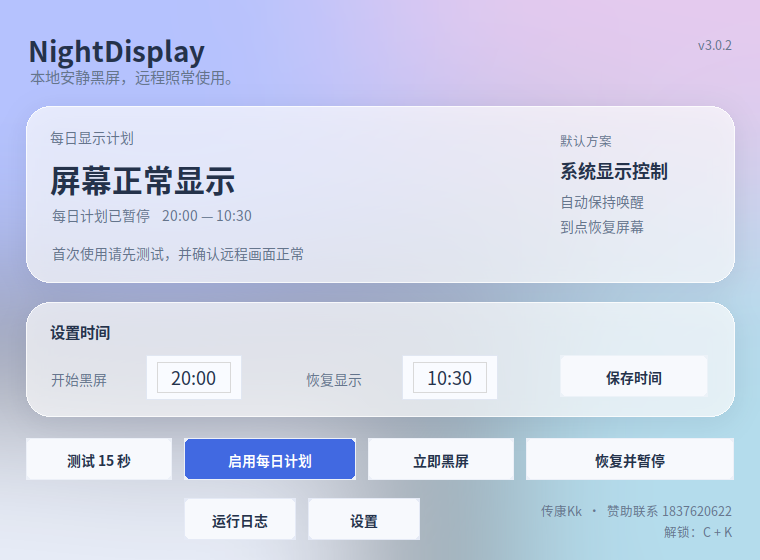

# NightDisplay

NightDisplay 在指定时段关闭本地显示输出，同时保持电脑运行，方便你继续通过 UU 远程、ToDesk 等软件连接。默认时间为每天 20:00 到次日 10:30，支持多个时间段和跨午夜计划，按电脑本地时区执行。

作者：传康Kk。赞助及联系：1837620622。

[下载正式版本](https://github.com/CKNB888/NightDisplay/releases/latest) · [反馈问题](https://github.com/CKNB888/NightDisplay/issues)

## 宣传片

[](docs/promo/nightdisplay.mp4)

人走了，屏幕按计划变成纯黑。远程桌面照常能看、能操作。点图片播放。

## 日常使用

Windows 默认优先使用常驻虚拟屏。进入夜间时，桌面只输出到虚拟屏，实体屏从桌面布局中移除；恢复时还原原来的显示配置。普通鼠标和键盘输入不会重新启用被移除的实体输出。

如果虚拟屏无法使用，程序先回滚，再按系统能力尝试防窥黑幕和基础关屏。界面和日志会记录实际使用的方式。基础关屏兼容性较好，但输入会唤醒屏幕；它无法提供虚拟屏相同的效果。

NightDisplay 只负责显示、电源和时间计划。远程连接仍由 UU、ToDesk 等软件提供，不绑定设备，也不限制客户端数量；远程软件自身的会话规则继续生效。

## 界面



主窗口保留时间设置、测试、每日计划、立即黑屏和恢复操作。设置窗口提供额外时间段、解锁组合键、开机自启、更新检查和卸载。进度动画只画在这个设置窗口里。进入夜间后动画停止，本机黑屏是纯黑，没有文字、图标或渐变。

## 安装

| 平台 | 文件 | 使用方法 |
|---|---|---|
| Windows 10/11 x64 | `NightDisplay-Windows-x64-Setup.exe` | 按当前用户安装。驱动随包内置，首次打开自动装好，不用手动装驱动；驱动进系统才弹一次管理员确认，点了取消也照常打开、自动用黑幕模式。 |
| Windows 免安装 | `NightDisplay-Windows-x64.zip` | 解压到固定目录，运行 `NightDisplay.exe`。开启计划后不要移动程序。 |
| macOS Apple 芯片 | `NightDisplay-macOS-arm64.dmg` | 打开后拖入 Applications。也提供应用 ZIP。这个文件只在 Apple 芯片托管机完成构建后才会出现在 Release；正式版里没有它时，这一平台不算已发布。 |
| macOS Intel | `NightDisplay-macOS-x64.dmg` | 同上。 |
| Linux x64 | `NightDisplay-Linux-x64.tar.gz` | 解压后运行 `./NightDisplay`，需要 X11。构建基线为 Ubuntu 22.04，glibc 至少 2.35。 |

安装包尚未使用商业代码签名或 Apple 公证证书。源码、构建日志和校验值应一并核对，不能把未签名当成已经通过平台认证。

源码运行：

```bash
python -m pip install '.[tray]'
python -m nightdisplay
```

Linux 另外需要 tkinter、X11 工具和中文字体，例如 Ubuntu：

```bash
sudo apt install python3-tk x11-xserver-utils fonts-noto-cjk
```

## 第一次配置

1. 先确认远程软件已能正常连接这台电脑。
2. 不用手动装驱动。驱动随 Windows 包内置，首次打开软件自动装一次并写好开机自启注册表（HKCU Run，普通用户就有权限）；装不上或点了取消管理员确认，软件照常打开、自动降级到黑幕模式，功能正常。想重装驱动再去“设置”里点“重新安装内置驱动”。源码运行前先执行 `python tools/download_vdd.py`。运行中黑屏本身是纯黑，不带任何文字；进入和退出时的提示动画只在黑屏前后出现。
3. 设置主时间段，需要其他时段时打开“设置”，填入例如 `12:00-13:30, 02:00-04:00`。
4. 点“测试 15 秒”。程序会先启动独立恢复进程，再切换显示；测试与恢复属于同一会话，旧的恢复进程不会干扰后来的操作。
5. 测试恢复后，检查实体屏是否正常、远程是否能看到桌面，再启用每日计划。超过 24 小时的测试结果不能直接用于重新启用计划。

本地默认同时按住 C 和 K 约 0.3 秒解除。可以在设置里录制或填写 2～3 个键，例如 `Ctrl + K`。组合键解锁后，本次夜间剩余时间不再自动黑屏。

启用黑屏锁定时，程序内的本地恢复、应急快捷键和退出操作都不会解除黑屏。远程恢复可运行：

```text
NightDisplay.exe --action emergency
```

Windows 压缩包也提供 `Recover.cmd`。应急恢复会恢复显示并暂停计划。这里的锁定是程序的操作限制，不是操作系统的权限隔离；系统显示设置和恢复命令仍可改变屏幕状态。

## 默认设备和电源配置

新安装的 Windows 虚拟屏采用一块 1920×1080、60 Hz 的显示器配置，关闭自定义 EDID 和额外 HDR 选项。已有驱动的用户配置不会被直接覆盖。

内置驱动固定使用 VirtualDrivers 的 `25.7.23` 版本。构建时校验下载 ZIP 的 SHA-256，安装前再次核对 INF、DLL、CAT 的固定校验值和目录签名。安装期间只临时信任已经通过固定文件校验和有效签名检查的驱动签名者，结束时移除本次新增的发布者条目。详细来源见 [NOTICE.md](NOTICE.md)。

Windows 夜间使用临时电源计划，关闭该计划下的自动睡眠、自动休眠和合盖睡眠。防窥黑幕保持显示渲染唤醒，避免黑窗口跟着显示器关掉。仅虚拟屏只保持系统唤醒，允许显示器空闲，一体机背光可以灭。原电源计划保存在切换记录中，恢复后重新启用并删除临时计划，不会全局关闭 Windows 的休眠功能。如果你在夜间主动选择了另一份电源计划，恢复时保留你的选择。

常驻进程定时检查显示输出和唤醒进程。虚拟输出发生改变时尝试修复，唤醒进程失效时重新启动；无法确认成功时报告错误并尝试恢复。断电、关机、低电量强制保护及系统或组织策略无法由应用保证。

## 各平台能力

| 能力 | Windows | macOS | Linux |
|---|---|---|---|
| 每日多个时间段 | 计划任务 + 常驻检查 | LaunchAgent + 常驻检查 | systemd 用户定时器 + 常驻检查 |
| 常驻虚拟屏 | 包含安装器，首次需要管理员权限 | 暂无内置虚拟显示驱动 | 使用已连接的 X11 虚拟输出 |
| 防窥黑幕 | Windows 10 2004 及以上 | 未实现 | 未实现 |
| 基础关屏 | 支持，输入会唤醒 | `pmset`，输入会唤醒 | X11 DPMS，输入会唤醒 |
| 防睡眠 | 临时电源计划 + Windows 唤醒请求 | `caffeinate` | `systemd-inhibit`，需要 logind |
| 显示备份与还原 | 支持，带多级恢复与目标校验 | 基础关屏不修改显示布局 | 支持 xrandr 备份与还原 |
| 后台入口 | 系统托盘 | 菜单栏，需 macOS 真机复核 | 取决于桌面托盘支持 |
| 本地组合键 | 支持 | 需要输入监控权限 | 需要 X11 |

macOS 当前自动降级为基础关屏，不能承诺本地动鼠标也不亮。Linux Wayland 不提供通用的真实输出控制，程序会明确报错，避免误把 XWayland 虚拟布局当成实体屏控制。

Windows 防窥黑幕依赖系统的 `WDA_EXCLUDEFROMCAPTURE`。设置成功只能说明 Windows 接受了请求，不能证明每一种远程采集方式都兼容。使用 UU、ToDesk 的实际画面仍需分别验证。

## 备份与恢复

进入虚拟屏模式前，程序保存当前显示路径和模式。最近十份备份会轮转，最近一次正常配置另存一份。配置文件、显示备份和电源记录采用完整文件替换；多进程修改配置时加锁，避免后台进程覆盖前台设置。

恢复优先还原完整显示配置，再尝试保存的拓扑、仅内屏、扩展和复制。每一级除了检查 API 返回码，还检查活动显示器；恢复失败不会把状态写成“白天”或“测试成功”。损坏的显示备份不会阻止尝试系统恢复。

IPC 按数据目录隔离，使用随机端口和会话凭据；没有回复的夜间命令不会被直接重复执行。后台进程不再读取磁盘里的 PID 后按名称杀进程，防止误杀其他 Python 或系统进程。

## 更新和卸载

启动后在后台查询 GitHub 最新正式 Release，也可以在设置里手动检查。查询失败写入日志，不阻塞主窗口；发现更新后由你选择是否打开下载页。程序不自动运行下载文件。

卸载前先运行“恢复并暂停”或远程恢复命令。Windows 安装器会在卸载前执行恢复和任务清理，恢复失败时停止卸载。设置中的“卸载计划与自启”会移除计划和自启项；显示备份与日志保留。

## 命令行

```text
NightDisplay --action status
NightDisplay --action selfcheck
NightDisplay --action night [--mode auto|virtual_only|overlay|screen_off]
NightDisplay --action day
NightDisplay --action test --mode auto --seconds 15
NightDisplay --action activate --start 20:00 --end 10:30
NightDisplay --action pause
NightDisplay --action emergency
NightDisplay --action uninstall
NightDisplay --action displays
NightDisplay --action plan-virtual
NightDisplay --action install-vdd
NightDisplay --action uninstall-vdd
```

夜间和测试命令会确保常驻进程存在，以便组合键和黑幕能工作。`plan-virtual` 只生成和校验方案，不改变输出。所有失败命令返回非零退出码；锁定状态下拒绝普通 `day` 命令时返回 2。

可用 `--home PATH` 指定数据目录，计划任务、恢复进程和唤醒进程会继承该目录。`--debug` 把完整错误堆栈同时打印到终端。

## 数据目录

| 平台 | 默认目录 |
|---|---|
| Windows | `%LOCALAPPDATA%\NightDisplay` |
| macOS | `~/Library/Application Support/NightDisplay` |
| Linux | `$XDG_STATE_HOME/nightdisplay`，未设置时为 `~/.local/state/nightdisplay` |

包含 `config.json`、`backups`、`logs` 及运行时会话文件。日志保留最近三十天。报告问题时可以提供版本、`selfcheck` 输出和对应日志，无需提供远程账号或密码。

## 构建和测试

```bash
python -m pip install pytest pillow pystray build pyinstaller ruff
python -m pytest -v tests
python -m ruff check nightdisplay tests tools
python tools/ci_integration.py
python -m build --wheel
```

Windows 集成检查增加 `--vdd`。打包后的 EXE 由 `tools/qa_windows.py` 进行实际测试、组合键解锁、应急恢复、计划注册和卸载检查，不预填成功记录。

GitHub Actions 按平台分开跑。Windows 2022 和 Windows latest 的测试通过后，马上构建安装器与免安装包，并做打包产物 QA，不等 macOS，也不等 Linux。macOS Intel、macOS Apple 芯片、Ubuntu 各自测试通过后各自上传安装包；某一台分不到机器，只影响那一个平台。推送 `v*` 标签且 Windows QA 通过后，正式 Release 先发布 Windows 安装包。macOS 或 Linux 若随后构建成功，再把各自的包补进同一个 Release。工作流也支持手动运行。

云端 VM 和 CI 没有你的实际一体机、UU/ToDesk 会话及真实背光控制。它们能验证操作系统接口、恢复和打包流程，不能代替硬件兼容性测试。没有跑过的机型和平台不标注为“已保证兼容”。

## 更新记录

### 3.0.6

- 黑幕替换系统光标时只使用当前文档列出的光标标识。中途失败会立刻重载系统光标方案。应急恢复、独立白天恢复和新进程启动都会重载，不依赖上一个进程的内存标记。
- 驱动自动安装的七天冷却写在环境诊断之外的同一份记录里，刷新诊断不会把冷却时间清掉。已有虚拟屏时仍会按开机自启偏好写入并回读。
- 显示备份里的显示器记录如果不是对象，这份备份会被跳过，继续做系统拓扑恢复。
- 同一套硬件上，自动模式测通降级方案后可以启用计划，计划按测到的实际方式运行。硬件能力变化后必须重新测试。
- 仅虚拟屏或基础关屏时进程被强行结束，下次启动先恢复实体屏和系统光标。计划如果仍在夜间，随后的检查会再进入夜间。
- 两块虚拟屏同时存在时，优先使用内置的 VDD by MTT，不把已经活动的其他虚拟屏当成夜间目标。

### 3.0.5

- Windows 仅虚拟屏不再禁止显示器空闲：系统保持唤醒，一体机背光可以灭。防窥黑幕仍保持显示，避免黑窗口跟着显示器关掉。
- 防窥黑幕盖住整个虚拟屏幕，包括原点在主屏左侧或上方的副屏，并去掉圆角、边框和阴影。黑幕期间本机系统光标改为空白，退出夜间后恢复。仅虚拟屏不改光标，远程指针保持原样。
- 设置窗口在夜间收起。只有进入夜间前本来开着，白天才再显示；托盘自启不会因此弹出。夜间不再响应“打开主窗口”。
- 基础关屏会在夜间重复执行。键鼠把屏幕点亮后，下一轮检查会再关掉。
- Windows 每日计划在睡眠错过时间点后，醒来会补跑一次。计划模块不可用时仍退回原来的 schtasks 任务，任务名不变。
- 还原显示时先临时套用备份，确认已经出现实体屏，才写入系统显示数据库。备份里没有显示器名单时，也不会把只剩虚拟屏的结果写进去。
- 组合键或立即恢复若没走完，本段夜间也不会马上再黑一次。再次手动进入夜间会清掉上一次解锁。
- 只有虚拟屏时不再覆盖白天显示备份。Windows 不会把这种备份写进系统显示数据库。Linux 还原后必须还能看到实体输出。
- 名字里仅仅带 Virtual、或 Xorg 的 DVI-I-1-1，不再被当成虚拟屏。
- 不超过 1 分钟的夜间时段，手动进入后会保持到该段结束。
- 解锁和远程应急进了队列之后，客户端超时也不会把这次操作丢掉。
- 夜间电源记录丢失时，不会把正在用的夜间计划当成原来的计划。临时计划已经不存在时，不再挡住显示恢复。
- 托盘自启时装驱动和切换显示共用同一把动作锁。

### 3.0.4

- 白天手动进入夜间后，会保持到下一段计划的结束时间，不再被定时检查立刻拉回亮屏。
- 黑幕窗口只保留纯黑底色。进度动画留在设置窗口内，进入夜间后停止，避免本机看出电脑仍在运行。

### 3.0.3

- 托盘自启只唤醒已有常驻进程，不再重复弹出主窗口；托盘未在限定时间内就绪时回退到主窗口，避免只剩一个不可用的后台进程。
- 测试中断或提前退出不再记为成功；启用计划时要求实际解析出的模式与测试模式一致，防止自动模式在驱动或显示变化后误用旧测试结果。
- Windows 10 2004 以下不再显示不可用的防窥黑幕模式；旧系统会直接使用可用的虚拟屏或基础关屏。
- 配置校验覆盖运行时字段、正则表达式、组合键规范化和错误类型；损坏的电源记录、显示备份不会阻断恢复流程。
- IPC 严格校验端口，关闭操作可重复执行；退出时中止未完成测试并再次尝试恢复显示。
- 计划状态能识别额外时间段任务；日志目录不可写时不再影响显示或恢复操作。
- 增加 Ruff 检查配置和本地 lint 基线，修复未使用导入、异常链、文件句柄和导入顺序等问题。

### 3.0.2

- 按最新 main 重新审计，修复虚拟屏切换中不兼容的 Windows API 参数，夜间配置不再写成系统永久显示布局。
- 增加恢复目标校验；恢复失败保留待恢复状态。基础关屏和黑幕恢复不再误用以前的虚拟屏备份。
- 修复配置并发覆盖、固定临时文件冲突、IPC 超时后重复执行和不同数据目录串用常驻进程。
- 测试增加会话 ID，旧的延迟恢复不会解除新的黑屏；实际使用的降级方式会写入测试记录。
- 防睡眠改为可撤销的独立进程，检查启动和心跳；增加临时 Windows 电源计划及原计划恢复。
- 虚拟屏安装增加固定校验值、真实退出码、设备健康检查和默认 1080p/60 Hz 配置。
- 主界面改为磨砂卡片，保留多时间段、组合键录制、自启、日志和后台更新检查。
- 修复 wheel 构建遗漏，安装脚本和默认设备配置随 Python 包分发。
- Windows QA 改为真实测试流程；正式发布依赖打包产物 QA，并增加 Windows 安装器和 macOS DMG。

### 3.0.1

修正 Linux 构建基线、模式校验、预演命令、外部命令编码及计划清理；Windows 包开始内置 VDD 驱动。该版本仍有恢复状态、配置并发和测试覆盖不足，3.0.2 针对这些路径补充修复和回归检查。

## 许可

MIT，见 [LICENSE](LICENSE)。第三方许可见 [NOTICE.md](NOTICE.md)。NightDisplay 是独立项目，与 UU 远程、ToDesk 没有隶属关系，也不使用它们的标识或素材。
