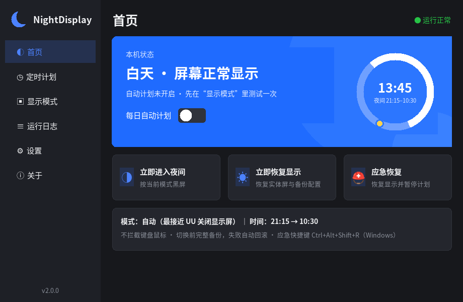
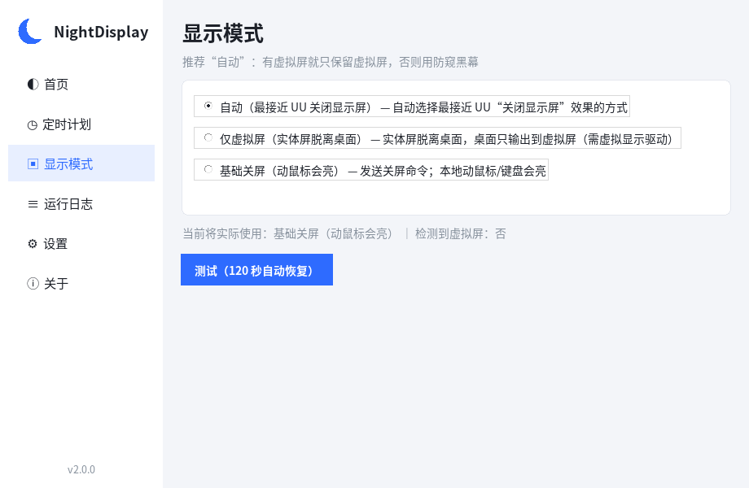
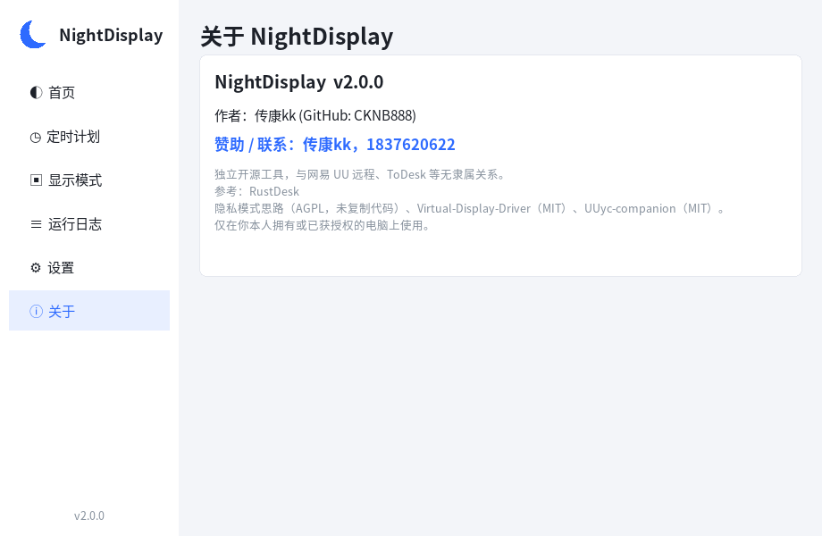

# NightDisplay 夜间黑屏 · 远程照常可用

> 每天到点让电脑**本地屏幕变黑**，电脑保持开机，**UU 远程 / ToDesk / RustDesk 等远程软件照常连接操作**；到点自动恢复。
> 适合一体机、办公室电脑、家里常开的主机：晚上不亮屏、不被旁人看到，远程随时能用。

作者：**传康Kk**（GitHub [@CKNB888](https://github.com/CKNB888)） ｜ **赞助 / 联系：传康Kk，1837620622**

[下载最新版本（Releases）](https://github.com/CKNB888/NightDisplay/releases/latest)

## 界面预览

| 首页（浅色） | 首页（深色） |
|---|---|
|  |  |
| **显示模式** | **关于** |
|  |  |

> 界面布局参考主流远程控制客户端（左侧导航、蓝色主卡片、圆角卡片、开关），图标与品牌均为 NightDisplay 自有设计，未使用任何第三方商标或素材。

---

## 功能一览

| 功能 | Windows | macOS | Linux |
|---|:-:|:-:|:-:|
| 每日自定义时间段（默认 20:00 → 10:30，可多段、可跨午夜） | ✅ 计划任务 | ✅ launchd | ✅ systemd 用户定时器 |
| 只保留虚拟屏（最接近 UU“关闭显示屏”） | ✅ 需虚拟显示驱动 | ⚠️ 需 BetterDisplay 等 | ✅ X11 + 虚拟输出 |
| 防截屏黑幕（本地黑、远程画面不黑） | ✅ Win10 2004+ | — | — |
| 基础关屏 | ✅ | ✅ pmset | ✅ xset dpms（X11） |
| 夜间阻止系统睡眠 | ✅ SetThreadExecutionState | ✅ caffeinate | ✅ systemd-inhibit |
| 切换前完整备份显示配置，失败分级回滚 | ✅ | — | ✅ |
| 应急恢复（托盘 / 快捷键 Ctrl+Alt+Shift+R / 命令行） | ✅ | ✅ | ✅ |
| 图形界面（侧边导航、状态卡、浅/深色） | ✅ | ✅ | ✅ |

## 显示模式说明

| 模式 | 效果 | 远程看到的画面 | 本地动鼠标 |
|---|---|---|---|
| **自动（默认）** | 有虚拟屏→只保留虚拟屏；否则 Win10 2004+ 用防窥黑幕；否则基础关屏 | 正常 | 视实际模式 |
| 只保留虚拟屏 | 实体屏从桌面移除（不输出信号，一体机通常背光也会关） | 正常（远程看到的是虚拟屏） | 不会亮 |
| 防窥黑幕 | 全屏黑色窗口，已设置“不被截屏/录屏”，键鼠穿透 | 正常 | 不会亮 |
| 基础关屏 | 系统关显示器 | 正常 | **会亮** |

“只保留虚拟屏”需要一块虚拟显示器：
- **Windows**：在“显示模式”页点“安装虚拟显示驱动”（会弹出管理员确认），安装开源 [Virtual-Display-Driver](https://github.com/VirtualDrivers/Virtual-Display-Driver)（MIT）。
- **macOS**：可用 BetterDisplay 创建虚拟屏，再配合系统设置；当前版本默认基础关屏。
- **Linux**：X11 下需要 `VIRTUAL*` / `DUMMY*` / evdi 虚拟输出；Wayland 不支持改输出，请切换到 X11 会话。

> 与 UU 远程的关系：UU 的“超级屏”会关闭实体屏且与 UU 虚拟屏互斥；UU 虚拟屏断开连接会自动删除。所以 NightDisplay 推荐使用**自己安装的常驻虚拟屏**，而不是依赖 UU 临时虚拟屏。UU 自带的“防窥模式 → 关闭显示屏”（Ctrl+Alt+P 解除）也可与本工具互补使用。

## 设置项

深色模式 · 开机自启（托盘常驻）· 黑屏锁定 · 解锁组合键录制/测试 · 额外时间段 · 检查更新（查询 GitHub 最新 Release）

## 安装

| 系统 | 下载 | 安装 |
|---|---|---|
| Windows 10/11 x64 | `NightDisplay-Windows-x64.zip` | 解压后双击 `NightDisplay.exe`（免安装）。SmartScreen 提示时点“更多信息 → 仍要运行”。 |
| macOS Apple 芯片 | `NightDisplay-macOS-arm64.zip` | 解压，把 `NightDisplay.app` 拖进“应用程序”，首次右键 → 打开（未签名）。 |
| macOS Intel | `NightDisplay-macOS-x64.zip` | 同上。 |
| Linux x64 | `NightDisplay-Linux-x64.tar.gz` | `tar xzf` 后运行 `./NightDisplay`；需要 X11 会话（Wayland 只能用基础功能）。最低 glibc 2.35（Ubuntu 22.04 / Debian 12 及以上）；虚拟屏/关屏需 `sudo apt install x11-xserver-utils`。 |

## 快速开始

1. 下载对应系统的压缩包（Actions 构建产物 / Release），解压。
   - Windows：双击 `NightDisplay.exe`
   - macOS：打开 `NightDisplay.app`（首次需右键→打开）
   - Linux：`./NightDisplay`（需要 X11）
2. **定时计划**页设置“进入夜间 / 恢复显示”时间，保存。
3. **显示模式**页选择模式（推荐“自动”），点“测试（120 秒自动恢复）”。**请先确认远程软件已能连上，并有人在电脑旁。**
4. 测试成功后回到首页，打开“每日自动计划”开关。（24 小时内没有成功测试过当前模式，不允许开启，防止远程把自己锁在外面。）

## 黑屏锁定与解锁组合键（v3 新增）

- 黑屏期间默认**锁定**：托盘“恢复/应急/退出”、主窗口按钮、Ctrl+Alt+Shift+R 在本地全部无效。
- 本地**唯一**解除方式：**同时按住 C 和 K**（约 0.3 秒）。可在“设置 → 解锁组合键”里点“录制”改成任意 2~3 键组合（如 Ctrl+X、Alt+Shift+9），并可点“测试”验证。
- 只读取按键状态，**不拦截、不吞掉任何按键**，远程和本地输入照常传给系统。
- 用组合键解锁后，本时段剩余时间不再自动黑屏；到计划结束时间（如 10:30）也会自动恢复。
- 隐藏的远程恢复（仅主人知道）：在远程会话里打开命令行运行 `NightDisplay.exe --action emergency`，不受锁定限制。
- macOS 首次使用会请求“输入监控”权限；Linux 需 X11 会话。

## 安全设计

- 不拦截键盘鼠标，不需要关闭杀毒，不注入任何远程软件，不修改 UU / ToDesk 客户端。
- 每次进入夜间前把当前显示配置**完整备份**（保留最近 10 份 + 最近一次正常配置）。
- 恢复按顺序尝试：完整备份 → 仅拓扑 → 仅内屏 → 扩展 → 复制，任何一级成功即停止。
- 切换后立即校验，失败**自动回滚**。
- 应急恢复：未锁定时可用托盘菜单 / `Ctrl+Alt+Shift+R`；任何时候都可在远程用命令行 `NightDisplay --action emergency`（恢复显示并暂停计划）。
- 一键卸载：设置页“卸载计划与自启”或 `--action uninstall`。

## 命令行

```
NightDisplay --action status          查看状态
NightDisplay --action night [--mode M] 立即进入夜间（M: auto/virtual_only/overlay/screen_off）
NightDisplay --action day             立即恢复
NightDisplay --action test --mode M --seconds 120   测试并自动恢复
NightDisplay --action activate --start 20:00 --end 10:30   开启每日计划
NightDisplay --action pause | emergency | uninstall
NightDisplay --action selfcheck       查看本机支持的模式
NightDisplay --action install-vdd | uninstall-vdd   安装/卸载虚拟显示驱动
NightDisplay --action displays        列出显示器（Windows/Linux）
NightDisplay --action plan-virtual    预演“只保留虚拟屏”（只校验，不应用）
NightDisplay --action install-vdd     安装虚拟显示驱动（Windows，管理员）
```

源码运行：`python -m nightdisplay`（Python 3.9+，需要 tkinter；可选 `pip install pystray pillow` 启用托盘）。

## 数据位置

| 系统 | 目录 |
|---|---|
| Windows | `%LOCALAPPDATA%\NightDisplay` |
| macOS | `~/Library/Application Support/NightDisplay` |
| Linux | `~/.local/state/nightdisplay` |

包含 `config.json`、`backups/`（显示配置备份）、`logs/`（保留 30 天）。

## 测试

```
python -m pytest tests            # 时间逻辑、配置、xrandr 解析、systemd/launchd 生成、Windows 结构体与备份还原
python tools/ci_integration.py    # 真机集成：计划任务注册/删除、防睡眠、显示备份还原、界面自检（Windows 加 --vdd）
```

GitHub Actions 在 Windows（latest/2022）、macOS（arm64/Intel）、Ubuntu 上自动跑全部测试并打包。

**仍需真机验证**：UU 远程连接后的实际画面、一体机背光是否真正熄灭、与 UU“超级屏/防窥模式”同时使用时的表现。CI 云主机没有真实显示器和 UU 客户端，无法覆盖这些。

## 常见问题

- **远程连上是黑的？** 远程端切换到虚拟屏画面；或按 Ctrl+Alt+Shift+R / 托盘“应急恢复”。
- **本地动鼠标屏幕亮了？** 你在用“基础关屏”模式，换成“只保留虚拟屏”或“防窥黑幕”。
- **电脑夜里睡眠了？** 确认设置里“夜间阻止系统睡眠”开启；笔记本合盖仍可能睡眠。

## 已知限制

- Windows“只保留虚拟屏”需要安装虚拟显示驱动（需管理员一次）；部分品牌一体机的背光由固件控制，需真机确认能否熄灭。
- “防窥黑幕”依赖 Win10 2004 及以上；更早系统会自动退回“基础关屏”。
- macOS 暂不支持托盘常驻：开机自启只会打开主窗口，关闭窗口即退出。
- macOS 目前只有“基础关屏”（动鼠标/键盘会亮），虚拟屏需要第三方工具（如 BetterDisplay）。
- Linux Wayland 不允许程序修改输出，只能在 X11 下使用虚拟屏/关屏。
- 程序未做代码签名，首次运行系统会提示。
- 与 UU 远程的实际配合（超级屏、防窥模式、虚拟屏断开自动删除）需在你的电脑上实测。

## 更新日志

### v3.0.1（2026-10-27）
- 修复：Linux 包改在 Ubuntu 22.04 构建，解决 Ubuntu 24.04 上图形界面因 `GLIBC_2.42` 打不开的问题；最低 glibc 2.35。
- 修复：`--mode` 必须是本系统支持的模式，非法模式直接报错（退出码非 0），不再“测试通过”、不再启动保持唤醒，也无法启用计划。
- 修复：Linux 上 `plan-virtual` 真正只预演，不再执行 xrandr、不再生成备份。
- 修复：`selfcheck` 按 auto 真实解析模式，并给出降级原因（`resolve_reason`）。
- 改进：缺少 xrandr/xset 提示安装 x11-xserver-utils；无 DISPLAY 时提示“未检测到 X11 会话”；终端只显示中文错误，完整堆栈写入 `logs/traceback.log`，加 `--debug` 才在终端打印。
- 修复：暂停/卸载在没有注册项时记录“无已注册项”；应急恢复出错时退出码非 0 并标注“部分失败”。
- 修复：暂停/卸载同时把配置里的开机自启关闭；`status`/`selfcheck` 分别显示自启“配置值”和“实际状态”。
- 修复：Windows 包内置 VDD 驱动（VirtualDrivers Driver.Only，MIT）于 `vdd/`，离线可装；安装脚本分步记录（下载、pnputil 返回码、创建设备），失败给出手动安装命令，日志在 `%LOCALAPPDATA%\NightDisplay\logs\install_vdd.log`；修复脚本在 Windows PowerShell 5 下的语法/编码错误（UTF-8 BOM + ASCII 输出）。
- 修复：Windows 删除计划任务时清理本程序创建的全部 `NightDisplay_*` 任务（不限 T23）；外部命令输出按系统代码页解码，避免中文乱码报错。
- 修复：Mac 压缩包顶层直接是 `NightDisplay.app`（去掉多余的 out/）；设置页与 README 注明 Mac 暂不支持托盘。

## 许可与致谢

MIT，见 [LICENSE](LICENSE)。第三方参考与商标说明见 [NOTICE.md](NOTICE.md)。本项目为独立工具，与网易 UU 远程、ToDesk 无隶属关系。

## 作者与赞助

- 作者：传康Kk（GitHub：[CKNB888](https://github.com/CKNB888)）
- **赞助 / 联系：传康Kk，1837620622**
